# Part I: the biomass operating truth

Part I generates a **completely known** biomass for every year and cell
of the domain. No fishing process is simulated at this stage. The
central identity is

\\ \begin{aligned} B(y, s) &= B\_{total}(y)\\ p(y, s) \\ p(y, s) &=
\frac{D(y, s)\\ A_s}{\sum\_{s'} D(y, s')\\ A\_{s'}} \\ \log D(y, s) &=
E(y, \text{lat}\_s) + H(s) + G(s) + Z(s) + \varepsilon(y, s)
\end{aligned} \\

where \\A_s\\ is the geodesic area of the cell. The terms are:

- \\E\\ is the latitudinal envelope, which may change in time
  (redistribution);
- \\H\\ are the hotspots and \\G\\ a longitudinal gradient;
- \\Z\\ is a persistent Gaussian random field;
- \\\varepsilon\\ is spatio-temporal AR(1) noise.

By construction \\\sum_s p(y,s) = 1\\ and \\\sum_s B(y,s) =
B\_{total}(y)\\ in every year.

``` r

library(pelagicOM)
library(ggplot2)
cfg <- om_biomass_config("BET_ICCAT")
sim <- simulate_biomass(cfg)
#> == 1. Spatial domain =============================
#>   domain BET-A: 10051 cells | lattice 130 x 140
#> == 2. Total biomass ==============================
#>  phase    period B_mean dep_ini dep_end u_mean
#>     Q1 1950-1968 977388   0.950   0.968 0.0229
#>     Q2 1969-1987 686371   0.870   0.510 0.1240
#>     Q3 1988-2006 319283   0.477   0.173 0.2478
#>     Q4 2007-2025 198468   0.179   0.318 0.2087
#> == 3. Static spatial structure ===================
#> == 4. Redistribution and spatio-temporal noise ===
#> == 5. Composition B(y, s) ========================
#>   long table: 763876 rows (76 years x 10051 cells)
```

The random draws always happen in the same order, so the same seed gives
the same result:

1.  the process error of \\B\_{total}\\;
2.  the persistent field \\Z\\;
3.  one Gaussian field per year for \\\varepsilon\\.

## 1. Total biomass

\\B\_{total}(y)\\ follows a Pella-Tomlinson surplus-production model
with an exogenous removal rate \\u(y)\\:

\\ \begin{aligned} SP(y) &= \tfrac{r}{p}\\ B(y)\\\big(1 -
(B(y)/K_y)^p\big) \\ B(y+1) &= \max\Big(\big\[B(y) + SP(y) - u(y)\\
B(y)\big\]\\ e^{\epsilon\_{y+1}},\\ B\_{floor}\Big) \end{aligned} \\

The process error \\\epsilon\\ is AR(1), bias corrected so that
\\E\[e^{\epsilon}\] = 1\\. \\K_y = K (1 + K\_{trend})^{y - y_0}\\.

``` r

str(cfg$population)
#> List of 14
#>  $ model       : chr "pella_tomlinson"
#>  $ K           : num 1e+06
#>  $ r           : num 0.3
#>  $ shape       : num 1
#>  $ B0_frac     : num 0.95
#>  $ u_base      : num 0.02
#>  $ decline     :List of 3
#>   ..$ start : num 1965
#>   ..$ end   : num 1995
#>   ..$ u_peak: num 0.26
#>  $ recovery    :List of 3
#>   ..$ start: num 2012
#>   ..$ end  : num 2025
#>   ..$ u_end: num 0.12
#>  $ u_smooth    : num 5
#>  $ K_trend     : num 0
#>  $ proc_sd     : num 0.05
#>  $ proc_rho    : num 0.4
#>  $ events      : list()
#>  $ B_floor_frac: num 0.001
reference_points(cfg$population)
#> $K
#> [1] 1e+06
#> 
#> $r
#> [1] 0.3
#> 
#> $shape
#> [1] 1
#> 
#> $Bmsy
#> [1] 5e+05
#> 
#> $MSY
#> [1] 75000
#> 
#> $umsy
#> [1] 0.15
```

The removal rate is drawn by phases: stable (`u_base`), a linear decline
up to `u_peak`, a plateau, a recovery down to `u_end`, and stable again.
The result is smoothed by a moving average of `u_smooth` years. Shocks
(`events`) multiply the biomass in given years:

``` r

fig_total_biomass(sim)
```

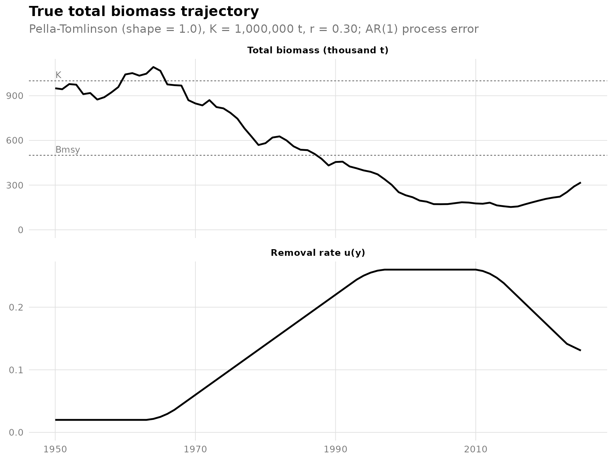

``` r

head(sim$pop)
#>   Year  B_total K_year    u   Surplus  Removal   Proc_error Depletion   B_Bmsy
#> 1 1950 950000.0  1e+06 0.02 14250.000 19000.00 -0.004677681 0.9500000 1.900000
#> 2 1951 943623.4  1e+06 0.02 15959.493 18872.47 -0.001722335 0.9436234 1.887247
#> 3 1952 978115.8  1e+06 0.02  6421.595 19562.32  0.038992708 0.9781158 1.956232
#> 4 1953 974045.8  1e+06 0.02  7584.180 19480.92  0.009356064 0.9740458 1.948092
#> 5 1954 910712.7  1e+06 0.02 24394.532 18214.25 -0.054941928 0.9107127 1.821425
#> 6 1955 918052.9  1e+06 0.02 22569.538 18361.06  0.001264269 0.9180529 1.836106
```

`population$model` can also be `"logistic"` or any function
`f(B, K, r, shape)` that returns the surplus production (see
[Tuning](https://rodrigosantana.github.io/pelagicOM/articles/tuning.md)).

## 2. Static habitat

The static part of the log-density is fixed in time and contains:

- **Latitudinal envelope.** A Gaussian on latitude, centred at
  `lat_center`, with different standard deviations north and south
  (`envelope_type = "latitude"`, the tropical core of Experimento 02).
  With `envelope_type = "abs_latitude"` it is a Gaussian on the absolute
  latitude instead: two symmetric bands, as for temperate species.
- **Hotspots.** Gaussian elevations at fixed positions.
- **Longitudinal gradient**, log-linear (`lon_gradient`).
- **Persistent random field** with standard deviation `field_sd` and
  spatial range `field_range` (degrees). It is obtained by smoothing
  white noise with a separable Gaussian kernel on the lattice,
  normalised so that every cell has the same marginal standard
  deviation.
- **User layer** (optional), `custom_effect(cells)`, for example a
  habitat covariate.

``` r

str(cfg$habitat)
#> List of 9
#>  $ envelope_type: chr "latitude"
#>  $ lat_center   : num 0
#>  $ lat_sd_north : num 11
#>  $ lat_sd_south : num 11
#>  $ hotspots     :List of 2
#>   ..$ :List of 5
#>   .. ..$ lon   : num -5
#>   .. ..$ lat   : num 0
#>   .. ..$ sd_lon: num 10
#>   .. ..$ sd_lat: num 5
#>   .. ..$ amp   : num 0.9
#>   ..$ :List of 5
#>   .. ..$ lon   : num -32
#>   .. ..$ lat   : num 4
#>   .. ..$ sd_lon: num 9
#>   .. ..$ sd_lat: num 5
#>   .. ..$ amp   : num 0.6
#>  $ lon_gradient : num 0
#>  $ field_sd     : num 0.45
#>  $ field_range  : num 4
#>  $ custom_effect: NULL
```

``` r

fig_base_habitat(sim)
```

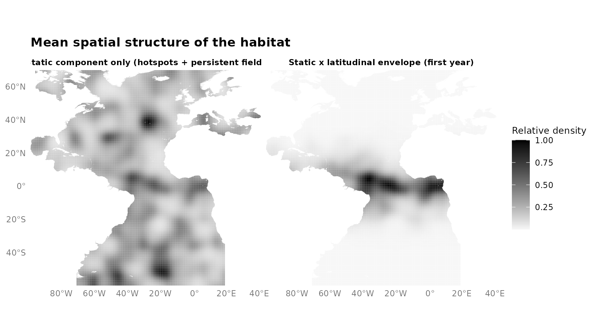

The components are stored in `sim$base`:

``` r

layer <- function(value, component) {
    x <- sim$dom$geometry
    x$value <- value
    x$component <- component
    x
}
comp <- rbind(layer(sim$base$hotspots, "Hotspots H(s)"),
              layer(sim$base$field, "Persistent field Z(s)"),
              layer(sim$base$envelope0, "Envelope E(first year, lat)"))
ggplot(comp) +
    geom_sf(aes(fill = value), colour = NA) +
    scale_fill_gradient2(low = "grey20", mid = "white", high = "black") +
    facet_wrap(~component) + coord_sf(expand = FALSE) +
    labs(fill = "log scale") + theme_pub(base = 9) +
    theme(legend.position = "right", panel.grid.major = element_blank())
```

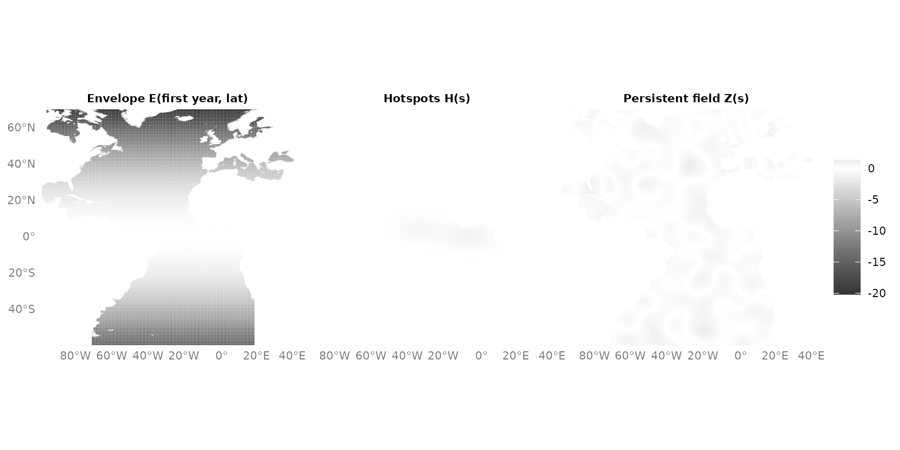

[`gaussian_random_field()`](https://rodrigosantana.github.io/pelagicOM/reference/gaussian_random_field.md)
is the building block of the random fields:

``` r

set.seed(1)
f <- gaussian_random_field(list(n_row = 60, n_col = 120), range = 4, sd = 1)
image(t(f), col = grey.colors(50), axes = FALSE, main = "range = 4, sd = 1")
```

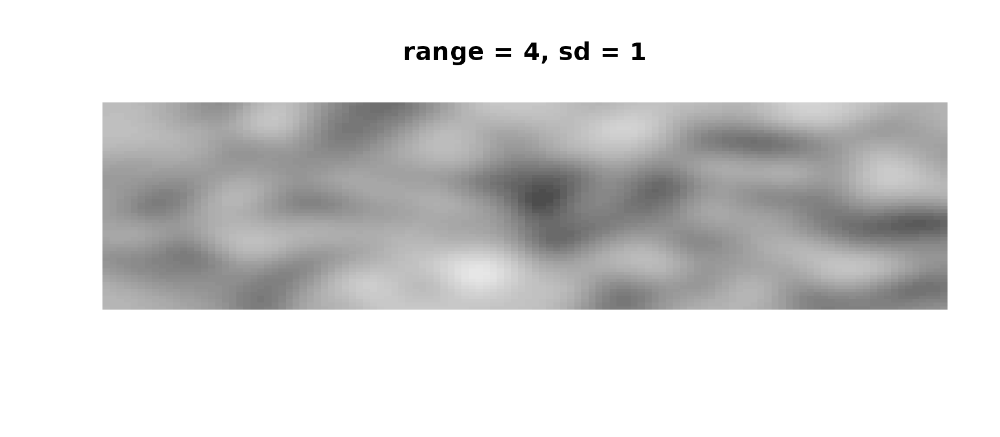

## 3. Redistribution in time

The envelope changes along a ramp \\f(y) \in \[0, 1\]\\ (linear or
logistic) between `shift$start` and `shift$end`:

\\ \begin{aligned} sd\_{north}(y) &= sd\_{north}\\\big(1 +
\text{north\\expansion}\\ f(y)\big) \\ sd\_{south}(y) &=
sd\_{south}\\\big(1 + \text{south\\expansion}\\ f(y)\big) \\ c(y) &= c +
\text{center\\drift}\\ f(y) \end{aligned} \\

An optional equatorial contraction lowers the log-density within
\\\|\text{lat}\| \<\\ `eq_band`. The weights are renormalised every
year, so a wider envelope moves share from the central region to the
outer regions without changing \\B\_{total}\\.

``` r

str(cfg$shift)
#> List of 10
#>  $ enabled               : logi TRUE
#>  $ start                 : num 1950
#>  $ end                   : num 2025
#>  $ ramp                  : chr "linear"
#>  $ ramp_steepness        : num 8
#>  $ north_expansion       : num 0.7
#>  $ south_expansion       : num 0.7
#>  $ center_drift          : num 0
#>  $ equatorial_contraction: num 0
#>  $ eq_band               : num 10
head(sim$envelope_params, 3); tail(sim$envelope_params, 3)
#>   Year       ramp center sd_north sd_south eq_contr
#> 1 1950 0.00000000      0 11.00000 11.00000        0
#> 2 1951 0.01333333      0 11.10267 11.10267        0
#> 3 1952 0.02666667      0 11.20533 11.20533        0
#>    Year      ramp center sd_north sd_south eq_contr
#> 74 2023 0.9733333      0 18.49467 18.49467        0
#> 75 2024 0.9866667      0 18.59733 18.59733        0
#> 76 2025 1.0000000      0 18.70000 18.70000        0
```

``` r

fig_envelope_profiles(sim)
```

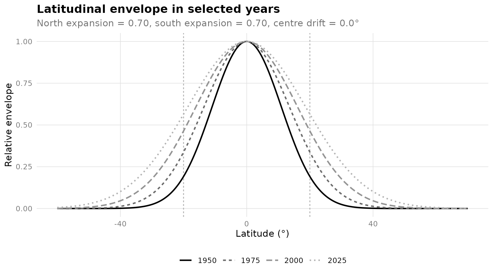

The same stock with and without redistribution:

``` r

sim_off <- simulate_biomass(om_config_update(cfg, shift = list(enabled = FALSE)),
                            long_table = FALSE, verbose = FALSE)
reg <- rbind(transform(regional_summary(sim), run = "shift on"),
             transform(regional_summary(sim_off), run = "shift off"))
ggplot(reg, aes(Year, Share, colour = Region, linetype = run)) +
    geom_line(linewidth = 0.7) +
    scale_colour_manual(values = c(R01 = "grey55", R02 = "black",
                                   R03 = "grey30")) +
    labs(y = "Share of total biomass") + theme_pub()
```

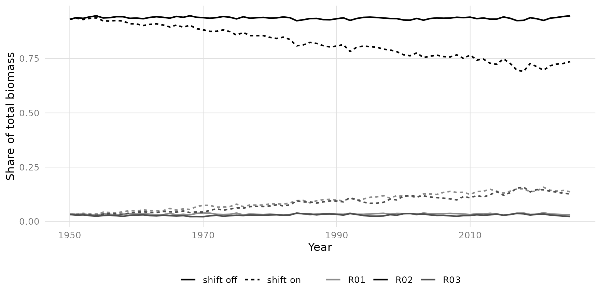

## 4. Spatio-temporal noise

\\ \varepsilon(y, s) = \rho\\ \varepsilon(y-1, s) + \sqrt{1 - \rho^2}\\
\xi_y(s) \\

where the \\\xi_y\\ are independent Gaussian fields with standard
deviation `sd` and range `range`. The marginal standard deviation is
`sd` in every year and the temporal correlation at lag \\k\\ is
\\\rho^k\\.

``` r

str(cfg$stochastic)
#> List of 4
#>  $ enabled: logi TRUE
#>  $ sd     : num 0.3
#>  $ range  : num 3
#>  $ rho    : num 0.6
round(cor(sim$noise[, "2000"], sim$noise[, "2001"]), 2)
#> [1] 0.67
```

## 5. Composition and the long table

The object returned by
[`simulate_biomass()`](https://rodrigosantana.github.io/pelagicOM/reference/simulate_biomass.md)
holds the matrices (cells x years) `envelope`, `noise`, `logD`,
`weights` and `biomass`. It also holds the long table `table`, one row
per year and cell, which is the main product of Experimento 02:

``` r

sim
#> <pelagicOM biomass truth> label 'base' | seed 20261005
#>   10051 cells x 76 years (1950-2025) | stock area BET-A
#>   B_total: 950,000 t (1950) -> 318,101 t (2025) | B/K 0.95 -> 0.32 | Bmsy 5e+05 t
#>   regional share: R01 0.04 -> 0.14 | R02 0.93 -> 0.74 | R03 0.03 -> 0.13
dim(sim$biomass)
#> [1] 10051    76
head(sim$table, 3)
#>   Year Cell_ID Longitude Latitude Region Area_km2 B_total Spatial_weight
#> 1 1950 5100000       0.5      0.5    R02 12308.78  950000    0.001268668
#> 2 1950 5100001       1.5      0.5    R02 12308.78  950000    0.001301248
#> 3 1950 5100002       2.5      0.5    R02 12308.78  950000    0.001338848
#>    Biomass    Density Relative_biomass Depletion
#> 1 1205.234 0.09791664         2.114591      0.95
#> 2 1236.186 0.10043121         1.983669      0.95
#> 3 1271.906 0.10333324         1.916429      0.95
```

## 6. Diagnostics

[`check_simulation()`](https://rodrigosantana.github.io/pelagicOM/reference/check_simulation.md)
runs two groups of checks:

- **Structural checks** stop the run when they fail: the identities
  above, no NA, Inf or negative values, unique Year x Cell, coherent
  regions.
- **Pattern checks** only warn: the central region is the densest at the
  start, and an active redistribution shifts share towards the outer
  regions.

``` r

chk <- check_simulation(sim)
#>   identities: max|sum p - 1| = 1.11e-16 | max rel |sum B - B_total| = 1.69e-16
#>   mean density in the first year (t/km2): R01=0.0010  R02=0.0328  R03=0.0011
#>   share (mean of the first vs last 10 years): R01 0.039 -> 0.144 | R02 0.928 -> 0.716 | R03 0.033 -> 0.140
#>   redistribution active: TRUE
check_reproducibility(cfg)
#>   reproducibility: OK (two identical runs)
```

Summaries used by the figures:

``` r

head(regional_summary(sim), 3)
#>       Year Region N_cells Area_km2   Biomass      Share Mean_density
#> 1950  1950    R01    4519 33645806  34833.40 0.03666674  0.001035297
#> 19501 1950    R02    2368 26975142 884745.28 0.93131082  0.032798541
#> 19502 1950    R03    3164 28135728  30421.32 0.03202244  0.001081235
head(centre_of_gravity(sim), 3)
#>      Year    Lat_cg    Lon_cg Abs_lat_cg Lat_cg_north Lat_cg_south Share_north
#> 1950 1950 0.2079612 -23.21777   7.586072     7.567370    -7.605928   0.5149763
#> 1951 1951 0.5444269 -22.64779   7.493810     7.571825    -7.405554   0.5307992
#> 1952 1952 0.4736220 -22.91766   7.582404     7.668030    -7.487651   0.5252996
head(latitude_profile(sim), 3)
#>   Year Lat_band      Density
#> 1 1950    -59.5 2.602283e-08
#> 2 1950    -58.5 4.345013e-08
#> 3 1950    -57.5 7.213174e-08
```

``` r

fig_maps(sim)
```

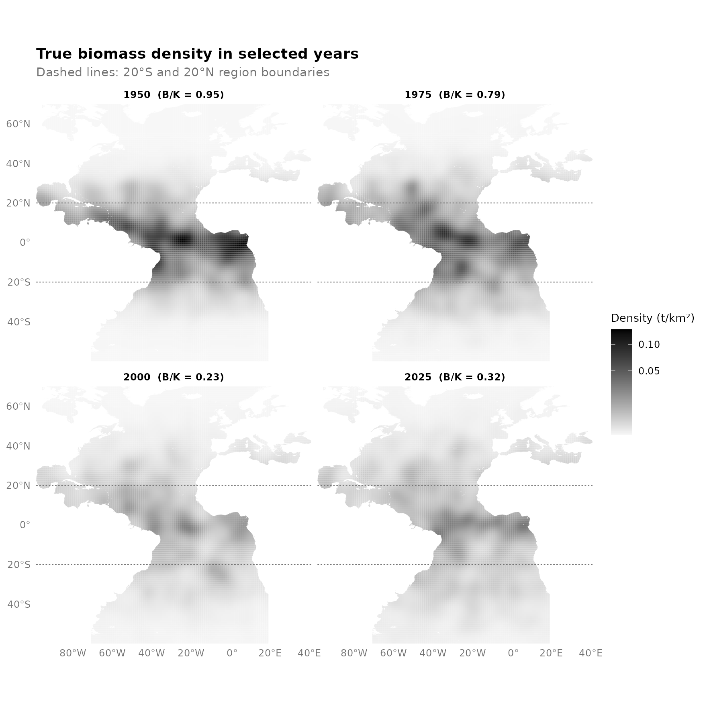

``` r

fig_region_biomass(sim)
```

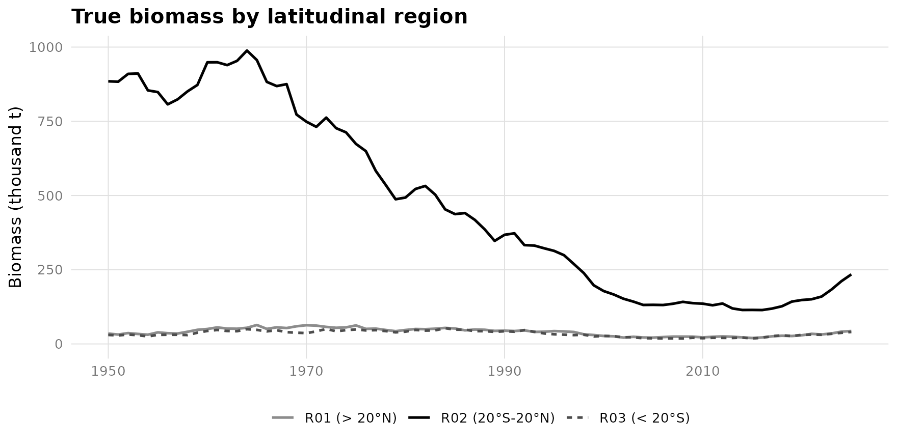

``` r

fig_region_share(sim)
```

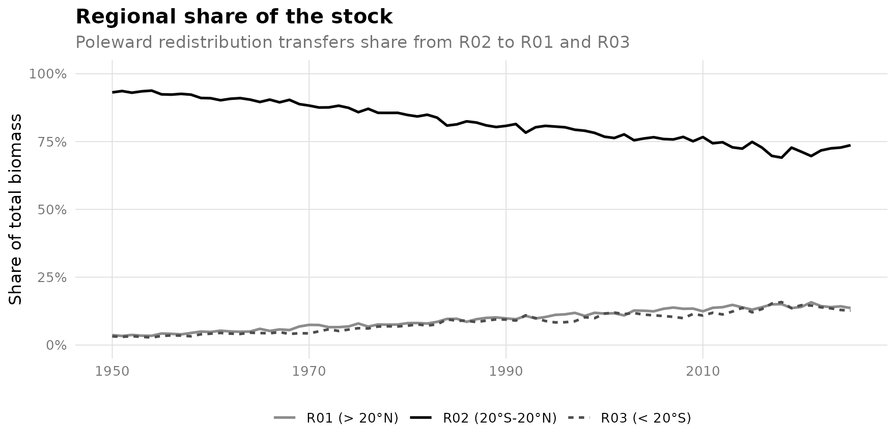

``` r

fig_centre_gravity(sim)
```

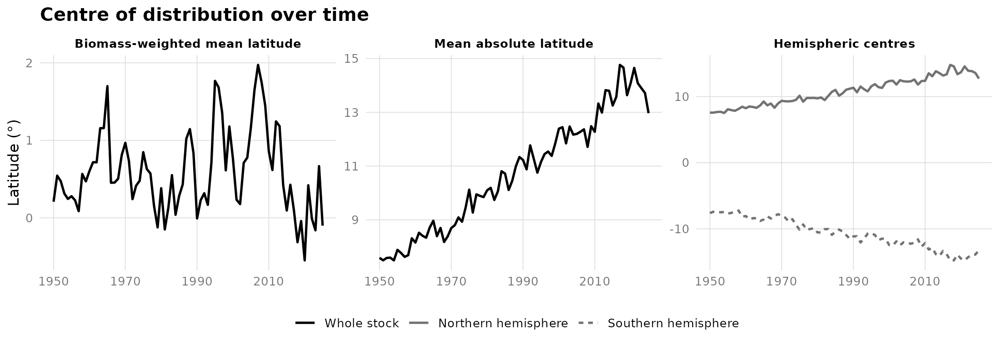

``` r

fig_hovmoller(sim)
```

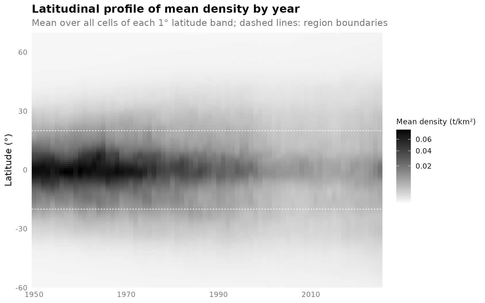

All eight figures can be built at once with `biomass_figures(sim)` or
saved as PNG with `make_biomass_figures(sim, dir)`.

## 7. Reproducibility

The whole run is controlled by `cfg$general$seed`.
[`simulate_biomass()`](https://rodrigosantana.github.io/pelagicOM/reference/simulate_biomass.md)
seeds its own random stream with the RNG kinds of Experimento 02
(Mersenne-Twister, Inversion, Rejection) and restores the caller’s
stream on exit:

``` r

set.seed(123); a <- runif(1)
set.seed(123); invisible(simulate_biomass(verbose = FALSE, long_table = FALSE))
identical(a, runif(1))
#> [1] TRUE
```
