# Part II: the longline fishery

Part II generates set-by-set pelagic longline operations on top of the
biomass truth and keeps the **complete truth of the fishing process**:
the latent strategy, the density at the set, every component of the
catchability, the expected catch and so on. The causal order is

> biomass → fleets → vessels → trips → sets → location → strategy → gear
> → catchability → expected catch → true catch → companion species

Effort is always the number of **hooks** per set. Everything that
changes the catch per hook (fleet, vessel, strategy, HBF, creep, space,
residual) is **catchability**.

``` r

library(pelagicOM)
library(ggplot2)
sim  <- simulate_biomass(om_biomass_config("BET_ICCAT"), verbose = FALSE)
fcfg <- om_fishery_config("BET_ICCAT")
fish <- simulate_fishery(sim, fcfg)
#> == 1. Population truth (Part I) ==================
#>   population truth: 10051 cells x 76 years (1950-2025)
#>   B_total 950000 t (1950) -> 318101 t (2025) | Part I label: 'base'
#> == 2. Fleets and vessels =========================
#>   826 vessels (13140 vessel-years)
#> == 3. Trips and sets =============================
#>   98782 trips | 1137186 sets | vessel-years with n_sets raised to n_trips: 0
#> == 4. Location of the sets =======================
#>   distinct cells fished: 6221 | sets by fidelity: 49.5%
#> == 5. Strategy and gear ==========================
#> == 6. Catchability and catch =====================
#>   mean catch 0.444 t | median 0.014 | zeros 49.7% | total 505430 t
#> == 7. Structural checks ==========================
#>   structural checks of the fishery truth: OK (1137186 sets)
fish
#> <pelagicOM fishery truth> label 'base'
#>   1,137,186 sets | 98,782 trips | 826 vessels | 5 fleets | 1950-2025
#>   target catch: total 505,430 t | mean 0.444 t/set | zeros 49.7%
#>   sets by fleet x region:
#>    
#>        R01    R02    R03
#>   A  33485 262520      0
#>   B  14577 248727      0
#>   C  24926 181206      0
#>   D      0 203569  18346
#>   E      0 125780  24050
```

Each stochastic module has its own seed (`fcfg$reproducibility$seeds`),
so changing one process does not reshuffle the draws of the others:

``` r

unlist(fcfg$reproducibility$seeds)
#>      vessels        trips         sets      spatial     strategy         gear 
#>     20261101     20261102     20261103     20261104     20261105     20261106 
#> catchability        catch      species  observation 
#>     20261107     20261108     20261110     20261109
```

## 1. Fleets

Each fleet has:

- a size (vessel slots kept active) and a period of activity;
- access to a set of regions, and a centre with a spread for its
  baseline spatial preference;
- seasonal weights for its trips and an effort trend (median hooks per
  set);
- an HBF multiplier and a composition of fishing strategies;
- a fleet effect on log q.

``` r

knitr::kable(fish$fleets)
```

| Fleet | n_vessels | year_start | year_end | regions | core_lon | core_lat | core_sd | q_effect | hbf_mult |
|:---|---:|---:|---:|:---|---:|---:|---:|---:|---:|
| A | 45 | 1950 | 2025 | R01+R02 | -45 | 12 | 20 | 0.00 | 1.0 |
| B | 40 | 1950 | 2025 | R01+R02 | -25 | 8 | 20 | 0.10 | 1.1 |
| C | 35 | 1958 | 2025 | R01+R02 | -15 | 22 | 18 | -0.35 | 0.8 |
| D | 40 | 1962 | 2025 | R02+R03 | -30 | -8 | 20 | -0.10 | 1.0 |
| E | 30 | 1968 | 2025 | R02+R03 | 0 | -18 | 18 | -0.25 | 0.9 |

New fleets are created with
[`om_fleet()`](https://rodrigosantana.github.io/pelagicOM/reference/om_fleet.md)
(see
[Tuning](https://rodrigosantana.github.io/pelagicOM/articles/tuning.md)).

## 2. Vessels, trips and sets

- Each fleet keeps `n_vessels` slots filled. When a vessel retires
  (career:

  N(`career_mean`, `career_sd`), at least `career_min` years), a new
  vessel enters the following year. The first cohort gets a uniform
  remaining career so that exits are staggered. Each vessel-year makes
  5-10 trips, each in a quarter drawn with the fleet weights, and each
  trip makes 8-15 sets (`sets$unit = "per_trip"`). The alternative
  `"per_vessel_year"` draws 8-15 sets per vessel-year, which is the
  literal original specification.

``` r

head(fish$vessels)
#>   VesselID Fleet Year_in Year_out Career Slot
#> 1    A_001     A    1950     1981     32    1
#> 2    A_002     A    1982     1997     16    1
#> 3    A_003     A    1998     2018     21    1
#> 4    A_004     A    2019     2025      7    1
#> 5    A_005     A    1950     1984     35    2
#> 6    A_006     A    1985     2000     16    2
nrow(fish$trips)
#> [1] 98782
```

``` r

av <- active_vessels_by_year(fish$vessel_years)
av$Year <- as.integer(as.character(av$Year))
ggplot(av, aes(Year, n_vessels, colour = Fleet)) +
    geom_line() + scale_colour_grey(end = 0.75) +
    labs(y = "Active vessels") + theme_pub()
```

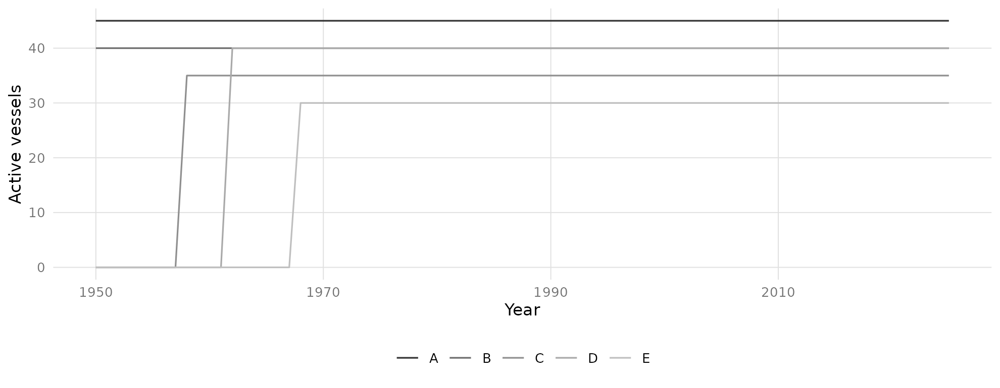

``` r

fig_effort_time(fish)
```

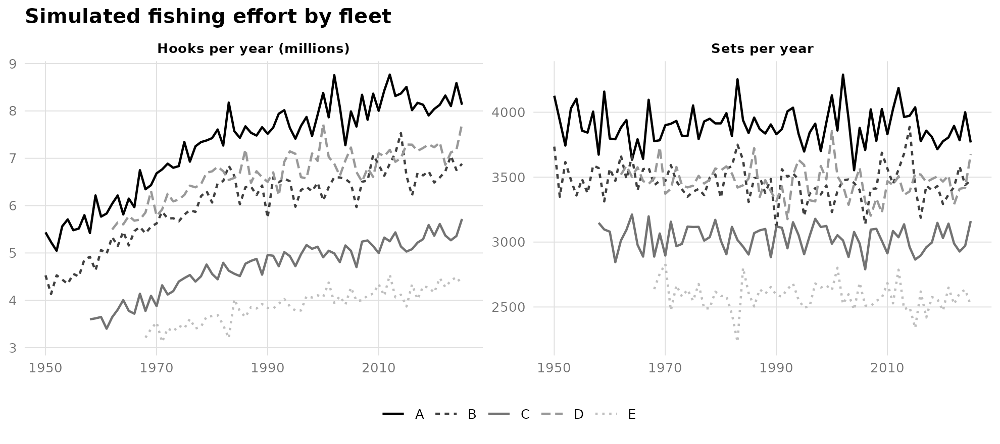

## 3. Where the sets are made

Within its footprint, a fleet chooses the cell of a set with probability

\\ P(s) \propto D(y, s)^{\theta}\\ g_f(s) \\

- \\\theta\\ is `preferential_sampling_strength` (1 in the base; 0
  removes the dependence on density).
- \\g_f\\ is a Gaussian preference around the fleet centre.
- The **footprint** is the accessible area (regions of the fleet),
  revealed from the centre outwards as the fleet expands
  (`expansion_profile`, a function of the years since the fleet
  started).
- With probability `fidelity`, a set repeats the cell of the previous
  set of the same vessel-year.

``` r

str(fcfg$spatial)
#> List of 6
#>  $ preferential_sampling_strength: num 1
#>  $ fidelity                      : num 0.5
#>  $ core_preference_enabled       : logi TRUE
#>  $ expansion_enabled             : logi TRUE
#>  $ expansion_profile             : Named num [1:3] 0.3 0.7 1
#>   ..- attr(*, "names")= chr [1:3] "0" "25" "50"
#>  $ density_floor                 : num 1e-06
table(fish$data$SpatialChoice) / nrow(fish$data)
#> 
#>   fidelity preference 
#>  0.4947229  0.5052771
```

``` r

fig_effort_maps(fish)
```

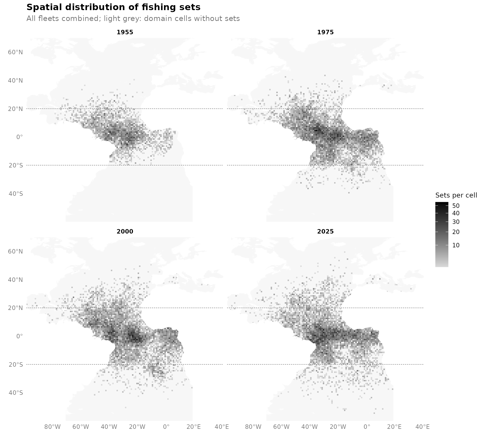

## 4. Fishing strategy and gear

The latent strategy (S1, S2, S3) of each set is drawn from the fleet
composition. The odds of `drift_level` (S1) grow in time
(`drift_S1_odds`). Hooks per set are lognormal around the fleet median
(CV `hooks_cv`, truncated to `hooks_range`). HBF follows the median of
the strategy, multiplied by the fleet multiplier, a persistent vessel
habit and lognormal noise per set:

``` r

str(fcfg$gear$hbf_by_strategy)
#> List of 3
#>  $ S1: Named num [1:4] 6 8 13 16
#>   ..- attr(*, "names")= chr [1:4] "1950" "1975" "1985" "2025"
#>  $ S2: Named num [1:4] 5 6 9 10
#>   ..- attr(*, "names")= chr [1:4] "1950" "1975" "1990" "2025"
#>  $ S3: Named num [1:2] 4 6
#>   ..- attr(*, "names")= chr [1:2] "1950" "2025"
```

``` r

fig_strategy(fish)
```

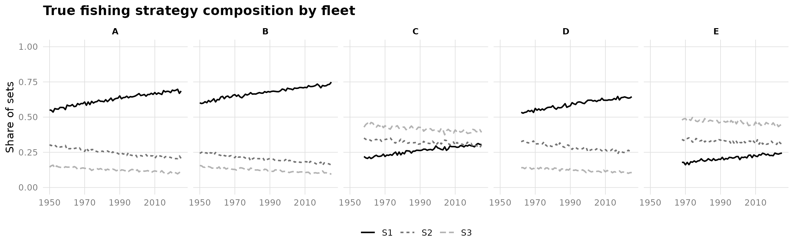

``` r

fig_gear(fish)
```

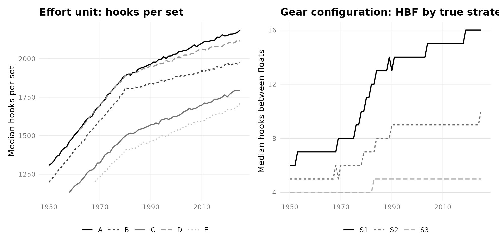

## 5. Catchability

\\ \begin{aligned} \log q = \log q_0 &+ \beta\_{fleet} + b\_{vessel} +
\beta\_{strategy} + f(HBF) \\ &+ c\\(y - y_0) + \beta\_{quarter} +
\beta\_{region} + Z_q(s) + e \end{aligned} \\

The terms are:

- \\b\_{vessel}\\ is a persistent random vessel effect (`vessel_sd`);
- \\f(HBF)\\ is saturating, \\a(1 - e^{-b(h-4)})\\, centred at the
  reference HBF;
- \\c\\ is the creep (1% per year in the base);
- \\Z_q\\ is a persistent spatial field of catchability;
- \\e\\ is a residual per set.

``` r

hb <- data.frame(HBF = 4:26)
hb$effect <- hbf_effect_fun(hb$HBF, fcfg$catchability$hbf)
ggplot(hb, aes(HBF, effect)) + geom_line() +
    geom_vline(xintercept = fcfg$catchability$hbf$ref, linetype = "22") +
    labs(y = "f(HBF) in log q") + theme_pub()
```

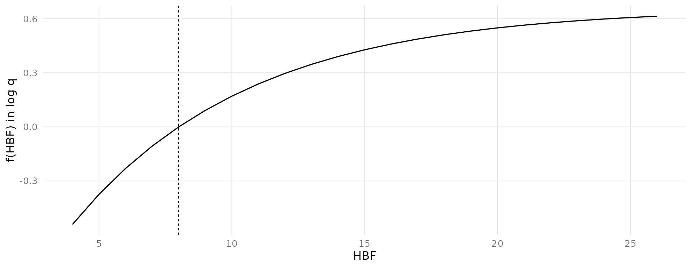

``` r

fig_catchability_time(fish)
```

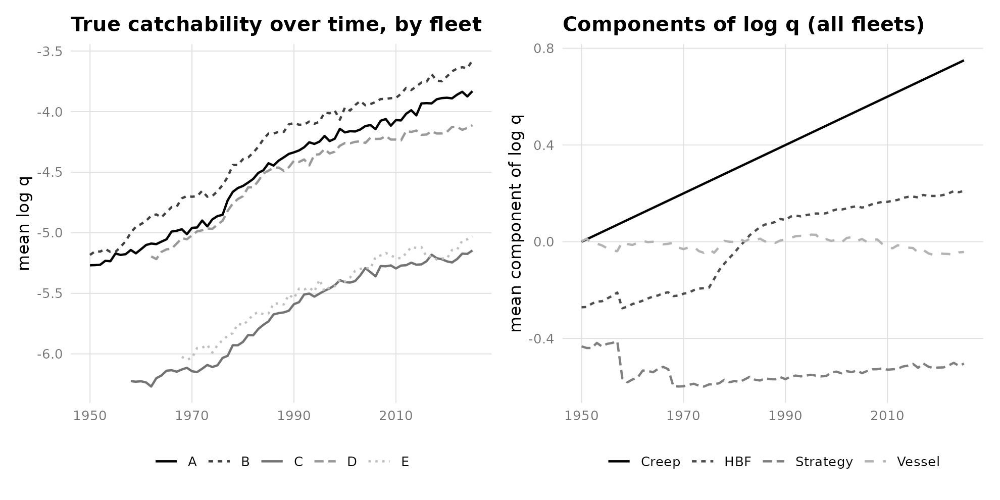

``` r

fig_catchability_factors(fish)
```

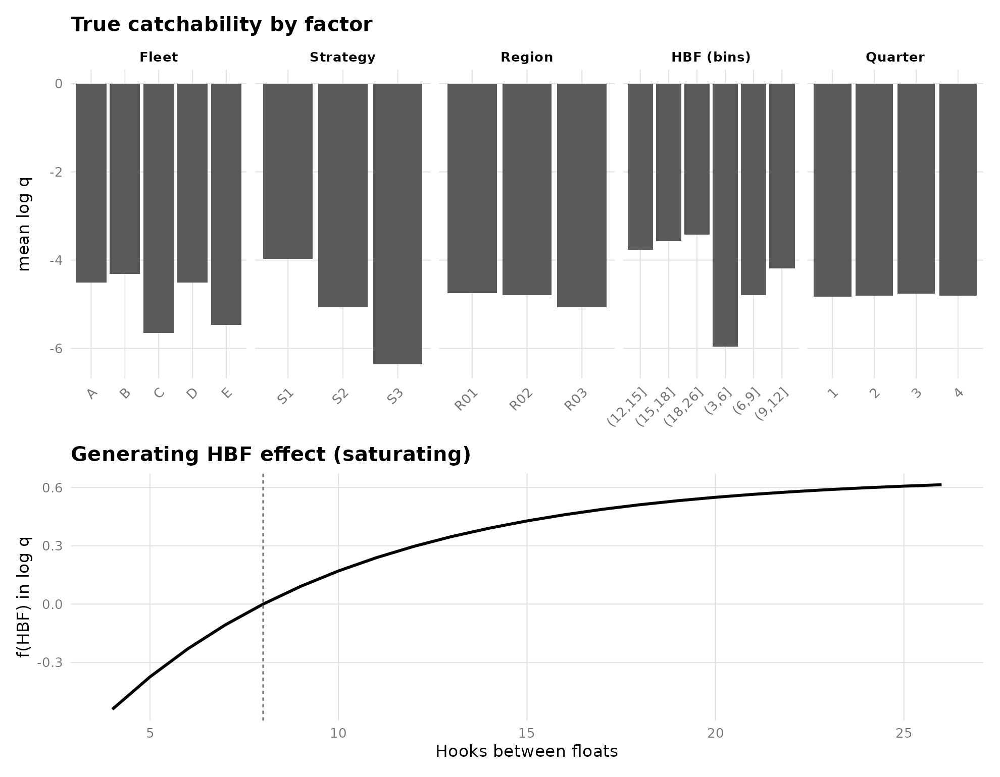

``` r

fig_vessel_effects(fish)
```

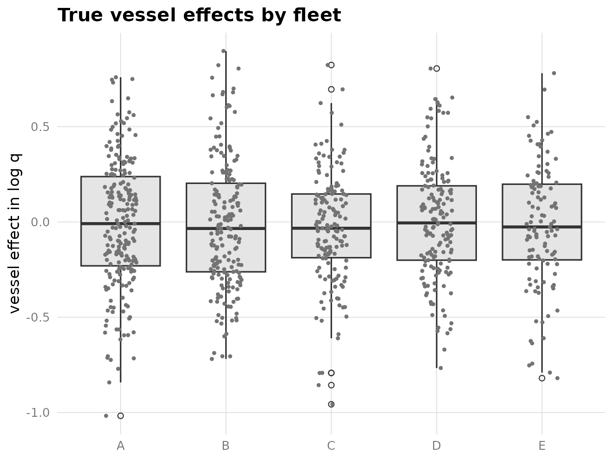

``` r

cq <- catchability_summary_table(fish$data)
knitr::kable(head(cq[cq$factor != "Year", c("factor", "level", "n_sets",
                                            "mean_log_q")], 12), digits = 3)
```

|     | factor             | level  |  n_sets | mean_log_q |
|:----|:-------------------|:-------|--------:|-----------:|
| 77  | Fleet              | A      |  296005 |     -4.507 |
| 78  | Fleet              | B      |  263304 |     -4.313 |
| 79  | Fleet              | C      |  206132 |     -5.653 |
| 80  | Fleet              | D      |  221915 |     -4.505 |
| 81  | Fleet              | E      |  149830 |     -5.473 |
| 82  | FishingStrategy    | S1     |  579474 |     -3.969 |
| 83  | FishingStrategy    | S2     |  305325 |     -5.073 |
| 84  | FishingStrategy    | S3     |  252387 |     -6.363 |
| 85  | Region             | R01    |   72988 |     -4.750 |
| 86  | Region             | R02    | 1021802 |     -4.789 |
| 87  | Region             | R03    |   42396 |     -5.066 |
| 88  | HooksBetweenFloats | (3,6\] |  387489 |     -5.959 |

## 6. Catch of the target species

The expected catch of a set is \\\mu = q \times \text{Hooks} \times D(y,
s)\\. Density is used, not biomass, because the gear samples a local
volume. The true catch is drawn from a Tweedie distribution (compound
Poisson-Gamma, power `power`, dispersion `dispersion`) or, optionally,
from a delta-lognormal one:

``` r

str(fcfg$catch_process)
#> List of 4
#>  $ distribution: chr "tweedie"
#>  $ power       : num 1.4
#>  $ dispersion  : num 1
#>  $ delta       :List of 3
#>   ..$ logit_a: num 1
#>   ..$ logit_b: num 1
#>   ..$ sdlog  : num 0.8
set.seed(1)
x <- rtweedie_cpg(rep(0.5, 1e5), p = 1.4, phi = 1)
c(mean = mean(x), prop_zero = mean(x == 0))
#>      mean prop_zero 
#> 0.4983827 0.3336500
```

``` r

fig_catch_distribution(fish)
```

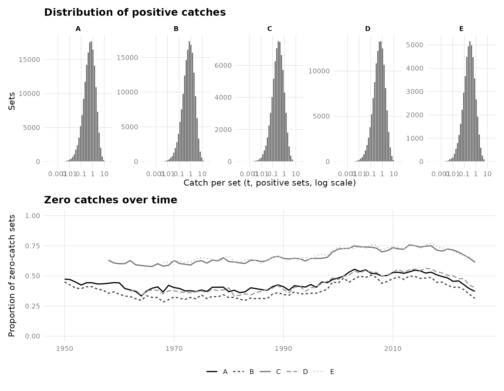

## 7. Companion species

Each companion species \\j\\ has an expected catch

\\ \begin{aligned} \log \mu_j = \log(\text{ref}\_j/1000) &+
\log(\text{Hooks}) + \beta_j\[\text{strategy}\] + h_j\\ g(HBF) \\ &+
E_j(\text{lat}) + \log T_j(y) + e \end{aligned} \\

and a Tweedie catch. The composition of the catch is the **signature of
the latent strategy**: deep sets (S1) catch BET and ALB, shallow sets
(S3) catch SWO and BSH. Methods based on clusters or on direct principal
components look for exactly this signature.

``` r

str(fcfg$species$params$SWO)
#> List of 7
#>  $ ref            : num 0.45
#>  $ strategy_effect: Named num [1:3] -2 -1 0
#>   ..- attr(*, "names")= chr [1:3] "S1" "S2" "S3"
#>  $ hbf_effect     : num -0.9
#>  $ lat_center     : num 20
#>  $ lat_sd         : num 20
#>  $ use_abs_lat    : logi TRUE
#>  $ trend          : Named num [1:2] 1 0.8
#>   ..- attr(*, "names")= chr [1:2] "1950" "2025"
```

``` r

fig_species_composition(fish)
```

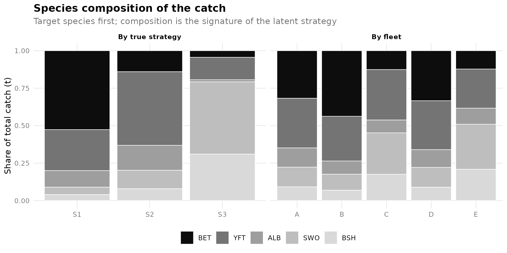

``` r

strategy_recovery_diagnostic(fish$data, fcfg)$summary
#>   n_sets k cluster_accuracy_best_match pc1_var_explained pc2_var_explained
#> 1  50000 3                     0.59572           0.29545            0.2259
#>   r2_pc1_vs_strategy r2_pc2_vs_strategy
#> 1          0.3604951         0.05271748
```

## 8. Nominal CPUE versus the truth

``` r

fig_cpue_vs_biomass(fish)
```

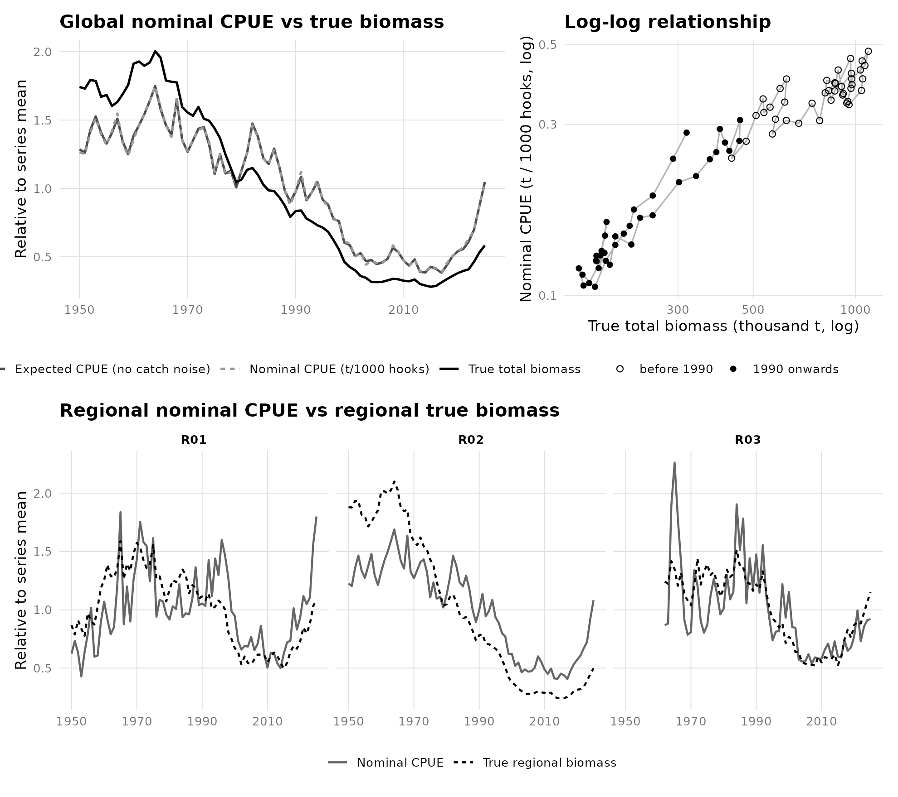

``` r

fig_cpue_fleet_strategy(fish)
```

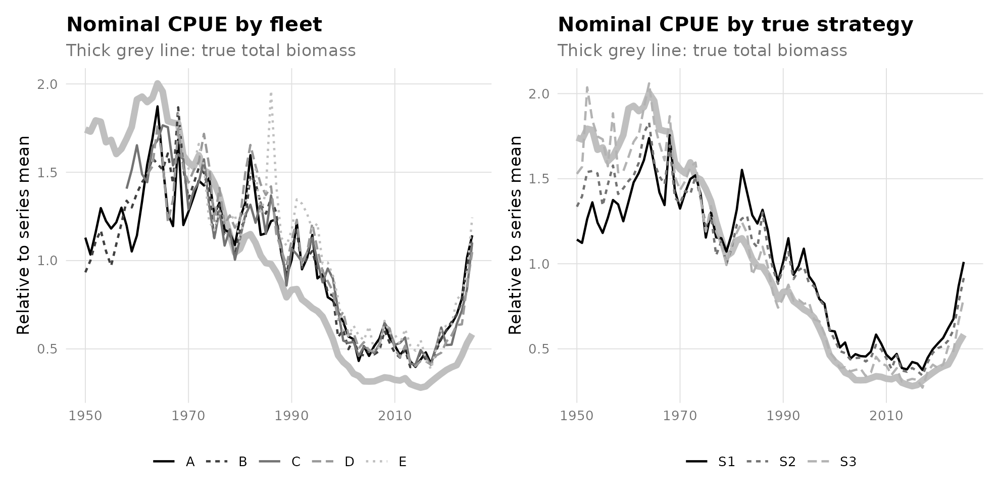

The log-log slope of nominal CPUE on true biomass is a quick diagnostic
of hyperstability (β \< 1):

``` r

tg <- cpue_biomass_table(fish$data, fish$truth)
tr <- cpue_biomass_table(fish$data, fish$truth, "Region")
knitr::kable(rbind(cpue_biomass_slopes(tg), cpue_biomass_slopes(tr)),
             digits = 3)
```

|     | factor | level | n_years | beta_raw | beta_expected | r_log |
|:----|:-------|:------|--------:|---------:|--------------:|------:|
| ALL | Global | ALL   |      76 |    0.664 |         0.668 | 0.968 |
| R01 | Region | R01   |      76 |    0.685 |         0.643 | 0.686 |
| R02 | Region | R02   |      76 |    0.550 |         0.554 | 0.956 |
| R03 | Region | R03   |      64 |    0.853 |         0.849 | 0.814 |

## 9. Structural checks

[`simulate_fishery()`](https://rodrigosantana.github.io/pelagicOM/reference/simulate_fishery.md)
always runs
[`check_fishery_truth()`](https://rodrigosantana.github.io/pelagicOM/reference/check_fishery_truth.md),
which stops on any violation:

- non-negative, finite catches;
- hooks and HBF within their ranges;
- identifier hierarchy (set within trip within vessel within fleet);
- cells and coordinates taken from the biomass truth;
- regional access of each fleet;
- vessel active in the year of the set;
- the identity \\E\[C\] = q \times \text{Hooks} \times D\\.

``` r

check_fishery_truth(fish$data, fish$truth, fish$vessels, fcfg)
#>   structural checks of the fishery truth: OK (1137186 sets)
```

All twelve figures are available through
`fishery_figures(fish, scenarios)` and
[`make_fishery_figures()`](https://rodrigosantana.github.io/pelagicOM/reference/fishery_figures.md).
The diagnostic tables are listed in
[`?fishery_diagnostics`](https://rodrigosantana.github.io/pelagicOM/reference/fishery_diagnostics.md).
