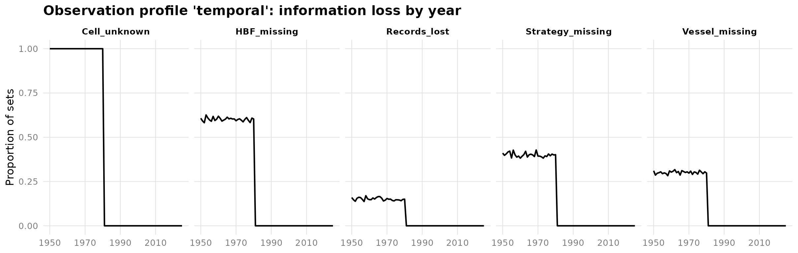

# Observation process and scenario data sets

The fishery truth holds every latent variable. A real logbook does not.
The **observation process** turns the truth into an *observed* data set,
and the **scenarios** select regions, variables and observation profiles
to build the data sets on which CPUE standardisations are tested.

``` r

library(pelagicOM)
library(ggplot2)
sim <- simulate_biomass(verbose = FALSE)
## fleets reduced to keep this article fast
fcfg <- om_fishery_config("BET_ICCAT",
    fleets = list(A = list(n_vessels = 12), B = list(n_vessels = 10),
                  C = list(n_vessels = 9), D = list(n_vessels = 10),
                  E = list(n_vessels = 8)))
fish <- simulate_fishery(sim, fcfg, verbose = FALSE)
```

## Observed and latent columns

``` r

fish$observed_columns
#>  [1] "Year"               "Quarter"            "Fleet"             
#>  [4] "VesselID"           "TripID"             "SetID"             
#>  [7] "Hooks"              "HooksBetweenFloats" "Region"            
#> [10] "Longitude"          "Latitude"           "Cell_ID"
fish$latent_columns
#>  [1] "TrueFishingStrategy" "TrueDensity"         "TrueBiomass"        
#>  [4] "TrueCatchability"    "log_q"               "q_fleet"            
#>  [7] "q_vessel"            "q_strategy"          "q_hbf"              
#> [10] "q_creep"             "q_quarter"           "q_region"           
#> [13] "q_spatial"           "q_resid"             "ExpectedCatch"      
#> [16] "ZeroProb"            "TrueCatch"           "SelectionProb"      
#> [19] "SpatialChoice"       "FootprintCells"      "FootprintFrac"      
#> [22] "HBF_vessel_habit"    "CellIndex"           "TripIndex"          
#> [25] "SetInTrip"           "SetOrder"            "Expected_YFT"       
#> [28] "Expected_ALB"        "Expected_SWO"        "Expected_BSH"       
#> [31] "TrueCatch_YFT"       "TrueCatch_ALB"       "TrueCatch_SWO"      
#> [34] "TrueCatch_BSH"       "TrueCatch_total"
```

An observed data set has these columns:

- the observable variables;
- `FishingStrategy`, the true strategy, which may be misclassified or
  missing;
- the catch of the target species (`Catch`) and of each companion
  species (`Catch_<sp>`).

## Observation profiles

A profile is a list of periods. Each period sets one parameter per
mechanism, and 0 switches a mechanism off:

| mechanism | parameter | effect |
|----|----|----|
| position error | `position_sd` | Gaussian error (degrees), re-anchored to the nearest domain cell |
| coordinate resolution | `coord_resolution` | 1 or 5; with 5, positions become 5x5 centres and `Cell_ID` becomes unknown |
| missing HBF | `hbf_missing` | probability that `HooksBetweenFloats` is NA |
| effort error | `hooks_cv`, `hooks_round` | multiplicative lognormal error and rounding of hooks |
| catch error | `catch_cv`, `catch_round` | multiplicative error and rounding of catches (zeros stay zero) |
| missing strategy | `strategy_missing` | probability that `FishingStrategy` is NA |
| missing vessel | `vessel_missing` | probability that `VesselID` is NA |
| record loss | `record_loss` | probability that a set is lost |

`strategies$misclassification` adds a misclassification of the observed
strategy. The observed region is always recomputed from the observed
latitude.

``` r

str(fcfg$observation$temporal)
#> List of 2
#>  $ :List of 11
#>   ..$ period          : num [1:2] 1950 1980
#>   ..$ position_sd     : num 0.5
#>   ..$ coord_resolution: num 5
#>   ..$ hbf_missing     : num 0.6
#>   ..$ hooks_cv        : num 0.15
#>   ..$ hooks_round     : num 100
#>   ..$ catch_cv        : num 0.2
#>   ..$ catch_round     : num 0.1
#>   ..$ strategy_missing: num 0.4
#>   ..$ vessel_missing  : num 0.3
#>   ..$ record_loss     : num 0.15
#>  $ :List of 11
#>   ..$ period          : num [1:2] 1981 2025
#>   ..$ position_sd     : num 0
#>   ..$ coord_resolution: num 1
#>   ..$ hbf_missing     : num 0
#>   ..$ hooks_cv        : num 0
#>   ..$ hooks_round     : num 1
#>   ..$ catch_cv        : num 0
#>   ..$ catch_round     : num 0
#>   ..$ strategy_missing: num 0
#>   ..$ vessel_missing  : num 0
#>   ..$ record_loss     : num 0
```

Every profile starts from the same seed (`seeds$observation`), so
profiles differ only by their parameters:

``` r

obs <- apply_observation_process(fish$data, "temporal", fcfg, fish$truth)
unlist(attr(obs, "mechanisms"))
#>                profile                 n_true strategy_misclassified 
#>             "temporal"               "293387"                    "0" 
#>     position_perturbed  position_cell_changed             coord_5deg 
#>               "102564"                "54970"               "102564" 
#>         region_changed            hbf_missing       strategy_missing 
#>                  "329"                "61621"                "40964" 
#>         vessel_missing        hooks_perturbed        catch_perturbed 
#>                "30896"               "102564"               "102564" 
#>           records_lost 
#>                "15438"
```

## Scenarios

A scenario has:

- a name;
- the regions kept;
- the variables removed (`drop`);
- the observation profile;
- a description of its objective.

The `BET_ICCAT` preset has the eight scenarios of Experimento 02:

``` r

sc <- do.call(rbind, lapply(fcfg$scenarios, function(s)
    data.frame(name = s$name, regions = paste(s$regions, collapse = "+"),
               drop = paste(s$drop, collapse = ", "),
               observation = s$observation, objective = s$objective)))
knitr::kable(sc)
```

| name | regions | drop | observation | objective |
|:---|:---|:---|:---|:---|
| 01_global_complete | R01+R02+R03 |  | complete | Referencia: todas as regioes e variaveis |
| 02_global_without_hbf | R01+R02+R03 | HooksBetweenFloats | complete | Efeito da ausencia de HBF (global) |
| 03_R02_complete | R02 |  | complete | Regiao central de maior abundancia e sobreposicao de frotas |
| 04_global_temporal_uncertainty | R01+R02+R03 |  | temporal | Qualidade dos dados inferior em 1950-1980 (global) |
| 05_R02_temporal_uncertainty | R02 |  | temporal | Qualidade dos dados inferior em 1950-1980 (R02) |
| 06_R01_complete | R01 |  | complete | Regional R01 completo |
| 07_R03_complete | R03 |  | complete | Regional R03 completo |
| 08_R02_without_hbf | R02 | HooksBetweenFloats | complete | Ausencia de HBF em analise regional (R02) |

``` r

scen <- generate_scenarios(fish)
#>   01_global_complete                293387 sets  R01+R02+R03
#>   02_global_without_hbf             293387 sets  R01+R02+R03
#>   03_R02_complete                   263046 sets  R02
#>   04_global_temporal_uncertainty    277949 sets  R01+R02+R03
#>   05_R02_temporal_uncertainty       248460 sets  R02
#>   06_R01_complete                    19079 sets  R01
#>   07_R03_complete                    11262 sets  R03
#>   08_R02_without_hbf                263046 sets  R02
scen
#> <pelagicOM scenario data sets> 8 data sets
#>   01_global_complete                 293387 sets  R01+R02+R03  complete
#>   02_global_without_hbf              293387 sets  R01+R02+R03  complete
#>   03_R02_complete                    263046 sets  R02          complete
#>   04_global_temporal_uncertainty     277949 sets  R01+R02+R03  temporal
#>   05_R02_temporal_uncertainty        248460 sets  R02          temporal
#>   06_R01_complete                     19079 sets  R01          complete
#>   07_R03_complete                     11262 sets  R03          complete
#>   08_R02_without_hbf                 263046 sets  R02          complete
knitr::kable(scen$metadata[, c("name", "period", "n_sets",
                               "differences_from_complete")])
```

| name | period | n_sets | differences_from_complete |
|:---|:---|---:|:---|
| 01_global_complete | 1950-2025 | 293387 | nenhuma (referencia) |
| 02_global_without_hbf | 1950-2025 | 293387 | variaveis removidas: HooksBetweenFloats |
| 03_R02_complete | 1950-2025 | 263046 | filtro regional: R02 |
| 04_global_temporal_uncertainty | 1950-2025 | 277949 | perfil de observacao: temporal |
| 05_R02_temporal_uncertainty | 1950-2025 | 248460 | filtro regional: R02; perfil de observacao: temporal |
| 06_R01_complete | 1950-2025 | 19079 | filtro regional: R01 |
| 07_R03_complete | 1962-2025 | 11262 | filtro regional: R03 |
| 08_R02_without_hbf | 1950-2025 | 263046 | filtro regional: R02; variaveis removidas: HooksBetweenFloats |

``` r

fig_observation_quality(fish, scen)
```



## Your own profiles and scenarios

Profiles and scenarios are ordinary lists in the configuration. For
example, the code below adds two things:

- a “modern noisy” profile, with small position and catch errors over
  the whole period and no vessel identity before 1990;
- two scenarios that use this profile: one global, and one restricted to
  the southern region without HBF.

``` r

fcfg2 <- fcfg
fcfg2$observation$modern_noisy <- list(
    list(period = c(1950, 1989), position_sd = 0.25, coord_resolution = 1,
         hbf_missing = 0.2, hooks_cv = 0.05, hooks_round = 10,
         catch_cv = 0.10, catch_round = 0, strategy_missing = 1,
         vessel_missing = 1, record_loss = 0.05),
    list(period = c(1990, 2025), position_sd = 0.25, coord_resolution = 1,
         hbf_missing = 0, hooks_cv = 0.05, hooks_round = 10,
         catch_cv = 0.10, catch_round = 0, strategy_missing = 1,
         vessel_missing = 0, record_loss = 0))
fcfg2$scenarios <- list(
    list(name = "noisy_global", regions = c("R01", "R02", "R03"),
         drop = character(0), observation = "modern_noisy",
         objective = "Small errors everywhere, no vessel ID before 1990"),
    list(name = "noisy_R03_without_hbf", regions = "R03",
         drop = "HooksBetweenFloats", observation = "modern_noisy",
         objective = "Southern region without HBF"))
fish2 <- simulate_fishery(sim, fcfg2, verbose = FALSE)
scen2 <- generate_scenarios(fish2)
#>   noisy_global                      286362 sets  R01+R02+R03
#>   noisy_R03_without_hbf              11147 sets  R03
scen2
#> <pelagicOM scenario data sets> 2 data sets
#>   noisy_global                       286362 sets  R01+R02+R03  modern_noisy
#>   noisy_R03_without_hbf               11147 sets  R03          modern_noisy
d <- scen2$datasets$noisy_global
tapply(is.na(d$VesselID), d$Year < 1990, mean)
#> FALSE  TRUE 
#>     0     1
```

The truth does not depend on the observation profiles: `fish2$data` is
identical to `fish$data`.

``` r

identical(fish$data, fish2$data)
#> [1] TRUE
```

The scenario data sets are written to `outputs/datasets/` by
[`om_write_fishery()`](https://rodrigosantana.github.io/pelagicOM/reference/om_write_fishery.md)
(see
[Outputs](https://rodrigosantana.github.io/pelagicOM/articles/outputs.md)).
