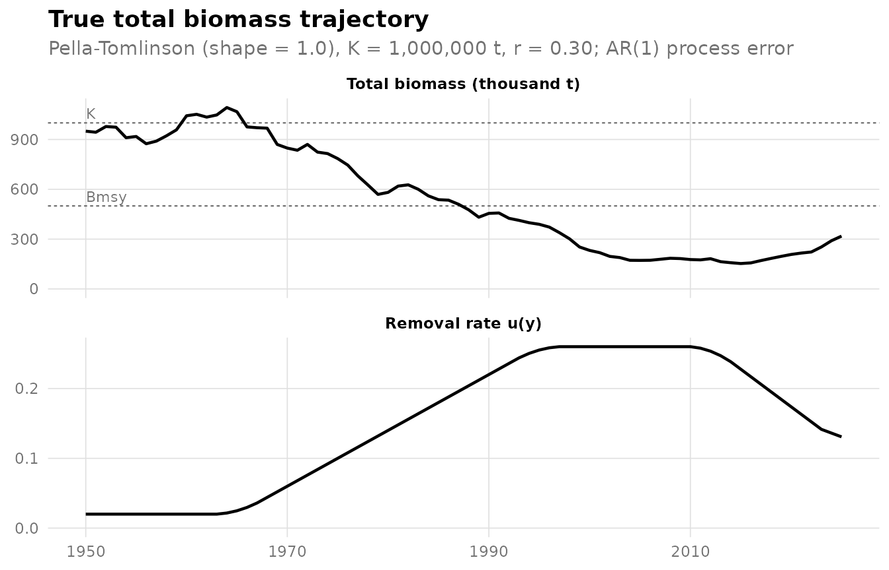
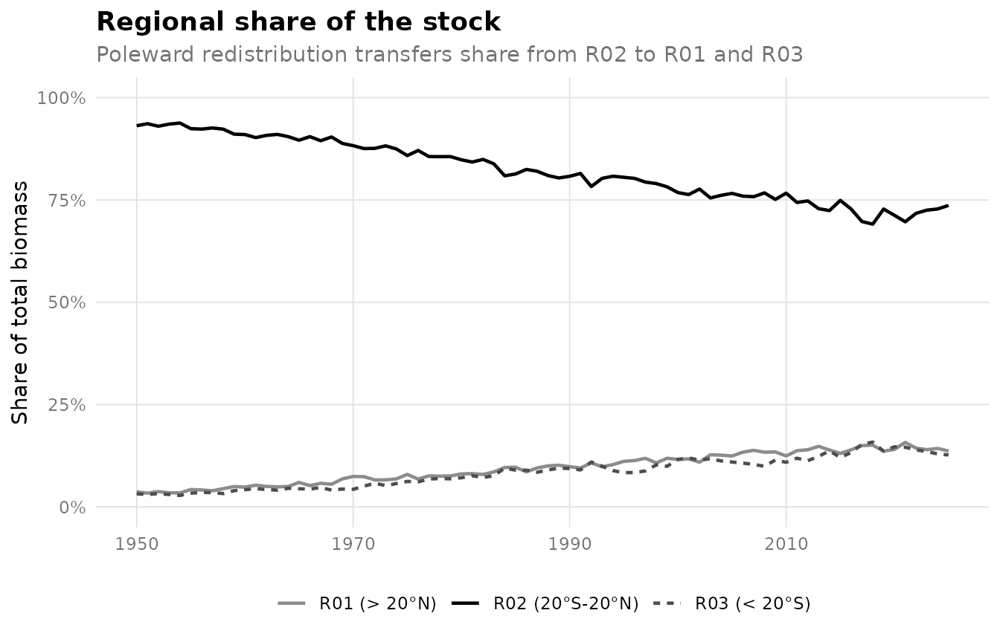
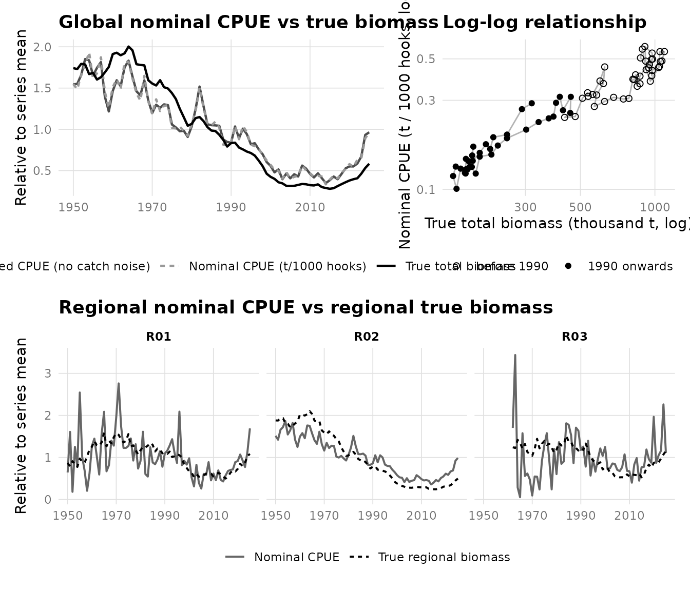

# Getting started with pelagicOM

`pelagicOM` builds a completely known **operating truth** for testing
CPUE standardisation methods. It has two parts, run one after the other:

1.  **Biomass (Part I)**: total biomass \\B\_{total}(y)\\ from a
    Pella-Tomlinson model with an exogenous removal rate, distributed
    over a 1x1 degree grid as \\B(y,s) = B\_{total}(y)\\p(y,s)\\. The
    weights \\p(y,s)\\ come from a static habitat (latitudinal envelope,
    hotspots, gradient, persistent Gaussian random field), a
    redistribution of the envelope in time and spatio-temporal AR(1)
    noise.
2.  **Fishery (Part II)**: set-by-set pelagic longline operations on top
    of the biomass truth. It covers fleets, vessels with careers, trips
    and sets, location by preferential sampling and fidelity, latent
    fishing strategies, hooks and hooks between floats (HBF), the
    components of log catchability, Tweedie catches and companion
    species. Observation profiles and scenario data sets are generated
    from the result.

The `"BET_ICCAT"` preset is the bigeye tuna operating model of
Experimento 02 and reproduces its results bit for bit.

``` r

library(pelagicOM)
om_presets()[, c("preset", "species", "area")]
#>      preset                      species
#> 1 BET_ICCAT Bigeye tuna (Thunnus obesus)
#>                                      area
#> 1 ICCAT BET-A stock area, 1x1 degree grid
```

## 1. Biomass truth

``` r

bcfg <- om_biomass_config("BET_ICCAT")
bcfg
#> <pelagicOM biomass configuration> label 'base' | seed 20261005 | 1950-2025 | stock area BET-A
#> sections: general, temporal, spatial, population, habitat, shift, stochastic, output 
#> population: pella_tomlinson, K = 1e+06, r = 0.3, shape = 1, B0/K = 0.95
#> habitat: latitude envelope, centre 0, sd N/S 11/11, 2 hotspot(s); shift on; noise on
sim <- simulate_biomass(bcfg, verbose = FALSE)
sim
#> <pelagicOM biomass truth> label 'base' | seed 20261005
#>   10051 cells x 76 years (1950-2025) | stock area BET-A
#>   B_total: 950,000 t (1950) -> 318,101 t (2025) | B/K 0.95 -> 0.32 | Bmsy 5e+05 t
#>   regional share: R01 0.04 -> 0.14 | R02 0.93 -> 0.74 | R03 0.03 -> 0.13
head(regional_summary(sim), 3)
#>       Year Region N_cells Area_km2   Biomass      Share Mean_density
#> 1950  1950    R01    4519 33645806  34833.40 0.03666674  0.001035297
#> 19501 1950    R02    2368 26975142 884745.28 0.93131082  0.032798541
#> 19502 1950    R03    3164 28135728  30421.32 0.03202244  0.001081235
```

``` r

fig_total_biomass(sim)
```



``` r

fig_region_share(sim)
```



## 2. Fishery truth and scenario data sets

The full BET fishery has about 1.1 million sets and takes around 15 s.
Here the fleets are reduced to keep the vignette fast:

``` r

fcfg <- om_fishery_config("BET_ICCAT",
    fleets = list(A = list(n_vessels = 6), B = list(n_vessels = 6),
                  C = list(n_vessels = 5), D = list(n_vessels = 5),
                  E = list(n_vessels = 4)))
fish <- simulate_fishery(sim, fcfg, verbose = FALSE)
fish
#> <pelagicOM fishery truth> label 'base'
#>   156,348 sets | 13,568 trips | 107 vessels | 5 fleets | 1950-2025
#>   target catch: total 73,779 t | mean 0.472 t/set | zeros 49.2%
#>   sets by fleet x region:
#>    
#>       R01   R02   R03
#>   A  4565 35435     0
#>   B  2182 36839     0
#>   C  3414 26076     0
#>   D     0 25205  2285
#>   E     0 17059  3288
scen <- generate_scenarios(fish, verbose = FALSE)
scen
#> <pelagicOM scenario data sets> 8 data sets
#>   01_global_complete                 156348 sets  R01+R02+R03  complete
#>   02_global_without_hbf              156348 sets  R01+R02+R03  complete
#>   03_R02_complete                    140614 sets  R02          complete
#>   04_global_temporal_uncertainty     147996 sets  R01+R02+R03  temporal
#>   05_R02_temporal_uncertainty        132718 sets  R02          temporal
#>   06_R01_complete                     10161 sets  R01          complete
#>   07_R03_complete                      5573 sets  R03          complete
#>   08_R02_without_hbf                 140614 sets  R02          complete
```

The true data keep every latent variable (true strategy, density,
catchability components, expected catch). The scenario data sets keep
only what a real logbook would contain:

``` r

fish$latent_columns[1:10]
#>  [1] "TrueFishingStrategy" "TrueDensity"         "TrueBiomass"        
#>  [4] "TrueCatchability"    "log_q"               "q_fleet"            
#>  [7] "q_vessel"            "q_strategy"          "q_hbf"              
#> [10] "q_creep"
names(scen$datasets[["04_global_temporal_uncertainty"]])
#>  [1] "Year"               "Quarter"            "Fleet"             
#>  [4] "VesselID"           "TripID"             "SetID"             
#>  [7] "Hooks"              "HooksBetweenFloats" "FishingStrategy"   
#> [10] "Region"             "Longitude"          "Latitude"          
#> [13] "Cell_ID"            "Catch"              "Catch_YFT"         
#> [16] "Catch_ALB"          "Catch_SWO"          "Catch_BSH"
```

``` r

fig_cpue_vs_biomass(fish)
```



## 3. Tuning the operating model

Every parameter is in the two configuration lists.
[`om_config_update()`](https://rodrigosantana.github.io/pelagicOM/reference/om_config_update.md)
(or the `...` of the configuration functions) merges named lists level
by level. Vectors and unnamed lists, such as hotspots or scenarios, are
replaced as a whole, and `NULL` removes an element.

``` r

cfg_fast <- om_config_update(bcfg,
    population = list(r = 0.45, decline = list(u_peak = 0.35)),
    shift = list(enabled = FALSE))
c(cfg_fast$population$r, cfg_fast$population$decline$u_peak)
#> [1] 0.45 0.35
```

### Another species and stock area

The package ships the official ICCAT 1x1 grid with the cells of every
ICCAT stock area:

``` r

head(iccat_stocks())
#>   stock_code                             layer
#> 1      ALB-M         albacore_tuna_stock_areas
#> 2      ALB-N         albacore_tuna_stock_areas
#> 3      ALB-S         albacore_tuna_stock_areas
#> 4      BFT-E atlantic_bluefin_tuna_stock_areas
#> 5      BFT-W atlantic_bluefin_tuna_stock_areas
#> 6      SAI-E     atlantic_sailfish_stock_areas
#>                                     name n_cells        selection
#> 1         Albacore tuna stock area ALB-M     431 point_on_surface
#> 2         Albacore tuna stock area ALB-N    5070 point_on_surface
#> 3         Albacore tuna stock area ALB-S    4550 point_on_surface
#> 4 Atlantic bluefin tuna stock area BFT-E    5853 point_on_surface
#> 5 Atlantic bluefin tuna stock area BFT-W    4198 point_on_surface
#> 6     Atlantic sailfish stock area SAI-E    5308 point_on_surface
```

A temperate tuna in the North Atlantic albacore area (ALB-N) is sketched
below. The latitudinal envelope is Gaussian on the absolute latitude,
with a preferred latitude of 32 degrees, and it drifts 4 degrees
poleward. The regions are bands split at 25 and 40 degrees N:

``` r

dom <- om_domain_iccat("ALB-N", region_breaks = c(25, 40),
                       region_labels = c("NORTH", "CENTRAL", "SOUTH"),
                       geometry = FALSE, verbose = FALSE)
alb <- om_biomass_config("BET_ICCAT",
    general    = list(label = "alb_n", seed = 2027),
    population = list(K = 5e5, r = 0.25, B0_frac = 0.90,
                      decline = list(start = 1960, end = 1990, u_peak = 0.20),
                      recovery = list(start = 2000, end = 2015, u_end = 0.08)),
    habitat    = list(envelope_type = "abs_latitude", lat_center = 32,
                      lat_sd_north = 7, lat_sd_south = 9,
                      hotspots = list(list(lon = -40, lat = 35, sd_lon = 12,
                                           sd_lat = 5, amp = 0.8))),
    shift      = list(north_expansion = 0, south_expansion = 0,
                      center_drift = 4))
sim_alb <- simulate_biomass(alb, dom, long_table = FALSE, verbose = FALSE)
cg <- centre_of_gravity(sim_alb)
cg[c(1, nrow(cg)), c("Year", "Lat_cg", "Lon_cg")]
#>      Year   Lat_cg    Lon_cg
#> 1950 1950 31.25568 -47.07561
#> 2025 2025 34.40408 -44.31650
```

The fleets, regional effects, target species and scenarios then follow
the new domain.
[`om_fleet()`](https://rodrigosantana.github.io/pelagicOM/reference/om_fleet.md)
returns a fleet specification with sensible defaults:

``` r

fcfg_alb <- om_fishery_config("BET_ICCAT", general = list(label = "alb_n"))
fcfg_alb$fleets <- list(
    JPN = om_fleet(n_vessels = 8, year_start = 1955,
                   regions = c("CENTRAL", "SOUTH"),
                   core_lon = -45, core_lat = 30),
    TWN = om_fleet(n_vessels = 6, year_start = 1965,
                   regions = c("NORTH", "CENTRAL", "SOUTH"),
                   core_lon = -35, core_lat = 38, q_effect = -0.2,
                   strategy_comp = c(S1 = 0.2, S2 = 0.6, S3 = 0.2)))
fcfg_alb$catchability$region_effect <- c(NORTH = 0, CENTRAL = 0, SOUTH = 0)
fcfg_alb$species$target <- "ALB"
fcfg_alb$species$companions <- c("BET", "SWO")
fcfg_alb$species$params <- list(BET = fcfg_alb$species$params$YFT,
                                SWO = fcfg_alb$species$params$SWO)
fcfg_alb$scenarios <- list(
    list(name = "01_all_complete", regions = c("NORTH", "CENTRAL", "SOUTH"),
         drop = character(0), observation = "complete",
         objective = "reference"),
    list(name = "02_central_temporal", regions = "CENTRAL",
         drop = character(0), observation = "temporal",
         objective = "degraded early data"))
fish_alb <- simulate_fishery(sim_alb, fcfg_alb, verbose = FALSE)
generate_scenarios(fish_alb, verbose = FALSE)
#> <pelagicOM scenario data sets> 2 data sets
#>   01_all_complete                     80868 sets  NORTH+CENTRAL+SOUTH complete
#>   02_central_temporal                 67576 sets  CENTRAL      temporal
```

Other entry points for tuning:

- `habitat$custom_effect = function(cells) ...` adds any static
  log-scale layer (for example a covariate) to the habitat;
- `population$model` accepts a function `f(B, K, r, shape)`;
- `population$events` adds abrupt shocks to the total biomass;
- [`om_domain_grid()`](https://rodrigosantana.github.io/pelagicOM/reference/om_domain_grid.md)
  builds a synthetic domain for any ocean box, and
  [`om_domain_from_gpkg()`](https://rodrigosantana.github.io/pelagicOM/reference/om_domain_from_gpkg.md)
  reads any ICCAT-like GeoPackage.

## 4. Writing the outputs and reproducing Experimento 02

[`om_run()`](https://rodrigosantana.github.io/pelagicOM/reference/om_run.md)
runs everything. When `dir` is given, it writes the files with the
folder structure and names of Experimento 02:

``` r

run <- om_run("BET_ICCAT", dir = "Experimento_pelagicOM")
#> Experimento_pelagicOM/Simulacao_Biomassa/outputs/data/biomass_true_base.rds
#> Experimento_pelagicOM/Simulacao_Pesca/outputs/truth/TRUE_FISHERY_DATA_base.rds
#> Experimento_pelagicOM/Simulacao_Pesca/outputs/datasets/01_global_complete.rds
#> ...
om_compare_reference(run, "R-Work/Experimento_02")
```

[`om_compare_reference()`](https://rodrigosantana.github.io/pelagicOM/reference/om_compare_reference.md)
compares the biomass, the long table, the fishery truth and the eight
scenario data sets with the reference files and reports whether each one
is [`identical()`](https://rdrr.io/r/base/identical.html). The script
`system.file("scripts", "reproduce_experimento02.R", package = "pelagicOM")`
runs the whole proof from the command line.

## Where to go next

The website articles describe each part of the model in detail:

- [Spatial
  domain](https://rodrigosantana.github.io/pelagicOM/articles/spatial-domain.html):
  ICCAT grid, stock areas, regions, GeoPackages, synthetic grids.
- [Part I:
  biomass](https://rodrigosantana.github.io/pelagicOM/articles/biomass.html)
  and [Part II:
  fishery](https://rodrigosantana.github.io/pelagicOM/articles/fishery.html).
- [Observation and
  scenarios](https://rodrigosantana.github.io/pelagicOM/articles/observation-scenarios.html).
- [Tuning](https://rodrigosantana.github.io/pelagicOM/articles/tuning.html),
  [outputs](https://rodrigosantana.github.io/pelagicOM/articles/outputs.html)
  and the [configuration
  reference](https://rodrigosantana.github.io/pelagicOM/articles/configuration-reference.html).
