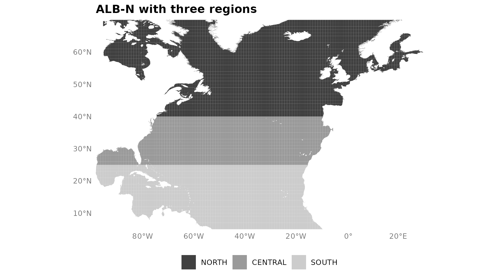
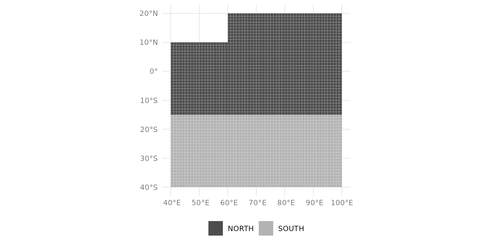

# Spatial domain: ICCAT grid, stock areas and regions

Every simulation runs on a **spatial domain**: a set of cells on a
regular 1x1 degree lattice, each with an identifier, a representative
point, a geodesic area and a latitudinal region. A domain is an object
of class `om_domain` with the same components as the domain of
Experimento 02:

| component | content |
|----|----|
| `cells` | one row per cell: `Cell_ID`, `Longitude`, `Latitude`, `Nominal_lon0`, `Nominal_lat0` (south-west corner of the nominal cell), `Row`, `Col` (lattice indices), `Area_km2`, `Area_frac` (fraction of the nominal cell that is sea), `Region` |
| `geometry` | `sf` polygons of the cells (used only by maps) |
| `lattice` | origin and size of the integer lattice used by the Gaussian random fields |
| `regions` | latitude `breaks` and `labels` of the regions |
| `meta` | provenance (source, stock code, area method, bounding box, …) |

``` r

library(pelagicOM)
library(ggplot2)
```

## The bundled ICCAT 1x1 grid

The package ships the 10,051 cells of the official ICCAT 1x1 grid (layer
`grids_01x01` of the ICCAT GIS GeoPackage). The cells are clipped by the
coastline and their areas are geodesic.
[`om_domain_iccat()`](https://rodrigosantana.github.io/pelagicOM/reference/om_domain_iccat.md)
builds a domain from it without any GIS file. For the BET-A stock area
the result is exactly the domain of Experimento 02:

``` r

dom <- om_domain_iccat("BET-A")
#>   domain BET-A: 10051 cells | lattice 130 x 140
dom
#> <pelagicOM spatial domain> BET-A (iccat)
#>   10051 cells | lattice 130 x 140 | lon -97.4 to 41.3 | lat -59.5 to 69.9
#>   regions: R01 = 4519, R02 = 2368, R03 = 3164 
#>   total area: 88,756,675 km2 | geometry: yes
head(dom$cells)
#>   Cell_ID Longitude Latitude Nominal_lon0 Nominal_lat0 Row Col Area_km2
#> 1 5100000       0.5      0.5            0            0  61  99 12308.78
#> 2 5100001       1.5      0.5            1            0  61 100 12308.78
#> 3 5100002       2.5      0.5            2            0  61 101 12308.78
#> 4 5100003       3.5      0.5            3            0  61 102 12308.78
#> 5 5100004       4.5      0.5            4            0  61 103 12308.78
#> 6 5100005       5.5      0.5            5            0  61 104 12308.78
#>   Area_frac Region
#> 1         1    R02
#> 2         1    R02
#> 3         1    R02
#> 4         1    R02
#> 5         1    R02
#> 6         1    R02
str(dom$lattice)
#> List of 4
#>  $ lon0_min: num -98
#>  $ lat0_min: num -60
#>  $ n_col   : num 140
#>  $ n_row   : num 130
```

Coastal cells are only partly sea (`Area_frac < 1`) and high-latitude
cells are smaller. The geodesic area is therefore what turns density
(t/km²) into biomass (t):

``` r

ggplot(dom$cells, aes(Latitude, Area_km2, colour = Area_frac < 1)) +
    geom_point(size = 0.4) +
    scale_colour_manual(values = c("black", "grey65"),
                        labels = c("open ocean", "coastal (clipped)")) +
    labs(y = "Cell area (km²)", colour = NULL) +
    theme_pub()
```


## ICCAT stock areas

Every stock area of the ICCAT GeoPackage is available. A cell belongs to
a stock area when a point on its surface lies inside the stock polygon.
BET-A is identical to the ICCAT Convention area, so it keeps all cells,
as in Experimento 02.

``` r

knitr::kable(iccat_stocks()[, c("stock_code", "name", "n_cells")])
```

| stock_code | name                                   | n_cells |
|:-----------|:---------------------------------------|--------:|
| ALB-M      | Albacore tuna stock area ALB-M         |     431 |
| ALB-N      | Albacore tuna stock area ALB-N         |    5070 |
| ALB-S      | Albacore tuna stock area ALB-S         |    4550 |
| BFT-E      | Atlantic bluefin tuna stock area BFT-E |    5853 |
| BFT-W      | Atlantic bluefin tuna stock area BFT-W |    4198 |
| SAI-E      | Atlantic sailfish stock area SAI-E     |    5308 |
| SAI-W      | Atlantic sailfish stock area SAI-W     |    4743 |
| WHM-A      | Atlantic white marlin stock area WHM-A |   10051 |
| BET-A      | Bigeye tuna stock area BET-A           |   10051 |
| BUM-A      | Atlantic blue marlin stock area BUM-A  |   10051 |
| SPF-E      | Longbill spearfish stock area SPF-E    |    5308 |
| SPF-W      | Longbill spearfish stock area SPF-W    |    4743 |
| SKJ-E      | Skipjack tuna stock area SKJ-E         |    5098 |
| SKJ-W      | Skipjack tuna stock area SKJ-W         |    4952 |
| SWO-M      | Swordfish stock area SWO-M             |     431 |
| SWO-N      | Swordfish stock area SWO-N             |    5070 |
| SWO-S      | Swordfish stock area SWO-S             |    4550 |
| YFT-A      | Yellowfin tuna stock area YFT-A        |   10051 |
| AT-NE      | AT-NE                                  |    2454 |
| AT-NW      | AT-NW                                  |    2616 |
| AT-SE      | AT-SE                                  |    2423 |
| AT-SW      | AT-SW                                  |    2127 |
| MD         | MD                                     |     431 |
| ICCAT      | ICCAT convention area                  |   10051 |

``` r

show_stocks <- function(codes) {
    g <- iccat_geometry()
    do.call(rbind, lapply(codes, function(cd) {
        d <- om_domain_iccat(cd, geometry = FALSE, verbose = FALSE)
        x <- g[g$Cell_ID %in% d$cells$Cell_ID, ]
        x$stock <- cd
        x
    }))
}
m <- show_stocks(c("ALB-N", "ALB-S", "ALB-M", "SKJ-E", "SKJ-W", "BFT-W"))
ggplot(m) +
    geom_sf(fill = "grey30", colour = NA) +
    facet_wrap(~stock, ncol = 3) +
    coord_sf(expand = FALSE) +
    labs(title = "Cells of some ICCAT stock areas") +
    theme_pub(base = 9) +
    theme(panel.grid.major = element_blank())
```


## Latitudinal regions

Regions are latitude bands defined by ascending `region_breaks` and by
`region_labels` listed **from north to south**. The default is the rule
of Experimento 02: R01 for lat \> 20, R02 for -20 ≤ lat ≤ 20 and R03 for
lat \< -20.

``` r

classify_regions(c(-35, -20, 0, 20, 35))
#> [1] R03 R02 R02 R02 R01
#> Levels: R01 R02 R03
table(dom$cells$Region)
#> 
#>  R01  R02  R03 
#> 4519 2368 3164
```

Any number of bands can be used. Regions without cells in a domain are
dropped with a message:

``` r

dom_alb <- om_domain_iccat("ALB-N", region_breaks = c(25, 40),
                           region_labels = c("NORTH", "CENTRAL", "SOUTH"))
#>   domain ALB-N: 5070 cells | lattice 65 x 129
table(dom_alb$cells$Region)
#> 
#>   NORTH CENTRAL   SOUTH 
#>    2523    1155    1392
g <- dom_alb$geometry
g$Region <- dom_alb$cells$Region
ggplot(g) +
    geom_sf(aes(fill = Region), colour = NA) +
    scale_fill_grey(start = 0.25, end = 0.8) +
    coord_sf(expand = FALSE) +
    labs(title = "ALB-N with three regions") +
    theme_pub() + theme(panel.grid.major = element_blank())
```



The regions are part of the domain. They are copied into the
configuration of the simulation, and they decide which cells each fleet
can fish and how the scenario data sets are filtered.

## Reading a GeoPackage

[`om_domain_from_gpkg()`](https://rodrigosantana.github.io/pelagicOM/reference/om_domain_from_gpkg.md)
is the function that built the domain of Experimento 02 from
`ICCAT_gis.gpkg`. It works as follows:

1.  It reads the grid layer and a stock-area layer.
2.  It repairs invalid geometries.
3.  It keeps the cells that belong to the stock.
4.  It computes geodesic areas with `lwgeom`.
5.  It derives the lattice indices and the regions.

With the defaults it returns the cells, lattice and polygons of
Experimento 02 exactly (this is checked by the package tests).

``` r

gpkg <- "Experimento_02/ICCAT/ICCAT_gis.gpkg"
inspect_geopackage(gpkg, layers = "albacore_tuna_stock_areas")

dom_bet <- om_domain_from_gpkg(gpkg)                      # BET-A, Exp. 02
dom_alb <- om_domain_from_gpkg(gpkg,
                               layer_stock = "albacore_tuna_stock_areas",
                               stock_code = "ALB-S",
                               selection = "point_on_surface")
```

The `selection` argument chooses the rule:

- `"intersects"` keeps every cell that touches the stock polygon. This
  is the rule of Experimento 02 and is adequate when the stock area is
  the whole Convention area.
- `"point_on_surface"` keeps a cell when a point on its surface lies
  inside the polygon. Cells that only share an edge with the boundary of
  a smaller stock area are left out, and the cells are the same as those
  of
  [`om_domain_iccat()`](https://rodrigosantana.github.io/pelagicOM/reference/om_domain_iccat.md).

A simulation can also read the GeoPackage itself, through
`spatial$source = "gpkg"` in the biomass configuration:

``` r

cfg <- om_biomass_config("BET_ICCAT",
                         spatial = list(source = "gpkg", gpkg = gpkg))
sim <- simulate_biomass(cfg)    # identical to the bundled-grid run
```

## Synthetic grids

For teaching, tests or other oceans,
[`om_domain_grid()`](https://rodrigosantana.github.io/pelagicOM/reference/om_domain_grid.md)
builds a rectangular 1x1 grid. `exclude` removes cells (for example
land) through a function of the cell centres. Areas are geodesic on the
WGS84 ellipsoid, computed exactly as for the ICCAT grid.

``` r

basin <- om_domain_grid(lon = c(40, 100), lat = c(-40, 20),
                        exclude = function(lon, lat) lat > 10 & lon < 60,
                        region_breaks = c(-15),
                        region_labels = c("NORTH", "SOUTH"))
#>   synthetic domain: 3400 cells | lattice 60 x 60
basin
#> <pelagicOM spatial domain> GRID (grid)
#>   3400 cells | lattice 60 x 60 | lon 40.5 to 99.5 | lat -39.5 to 19.5
#>   regions: NORTH = 1900, SOUTH = 1500 
#>   total area: 39,354,032 km2 | geometry: yes
g <- basin$geometry; g$Region <- basin$cells$Region
ggplot(g) + geom_sf(aes(fill = Region), colour = "white", linewidth = 0.05) +
    scale_fill_grey(start = 0.3, end = 0.7) + theme_pub()
```



[`geodesic_area_km2()`](https://rodrigosantana.github.io/pelagicOM/reference/geodesic_area_km2.md)
gives the area of any polygon in geographic coordinates:

``` r

cell <- sf::st_sfc(sf::st_polygon(list(cbind(c(0, 1, 1, 0, 0),
                                             c(0, 0, 1, 1, 0)))), crs = 4326)
geodesic_area_km2(cell)
#> [1] 12308.78
```

## Using a domain

By default
[`simulate_biomass()`](https://rodrigosantana.github.io/pelagicOM/reference/simulate_biomass.md)
builds the domain described in `cfg$spatial` (the bundled grid and the
BET-A area for the `BET_ICCAT` preset). Any other domain can be passed
explicitly. Its regions then take precedence over the ones in the
configuration:

``` r

sim <- simulate_biomass(om_biomass_config("BET_ICCAT"), domain = dom_alb)
```

See [Tuning the operating
model](https://rodrigosantana.github.io/pelagicOM/articles/tuning.md)
for complete examples with other stock areas.
