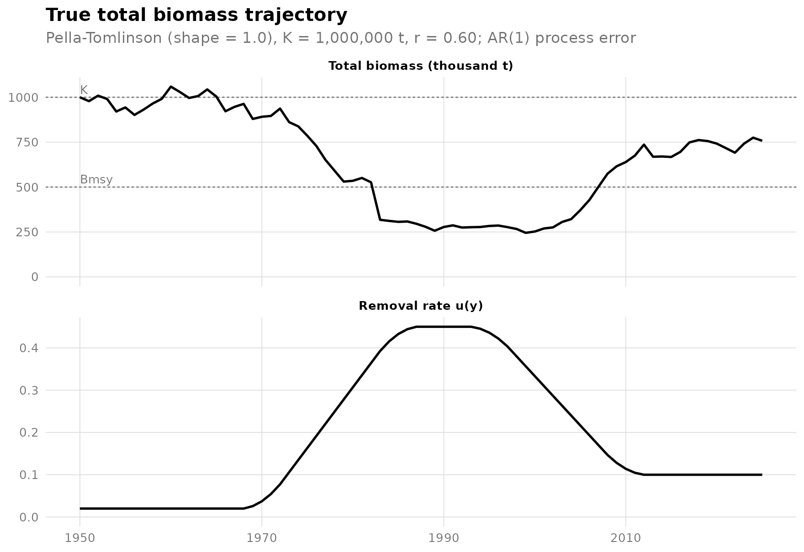
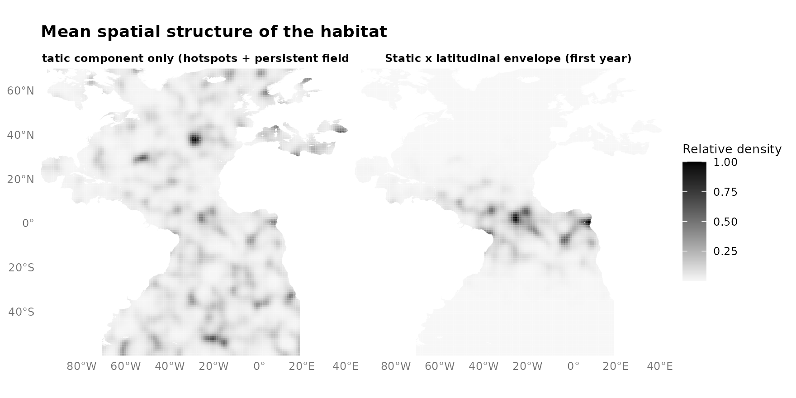
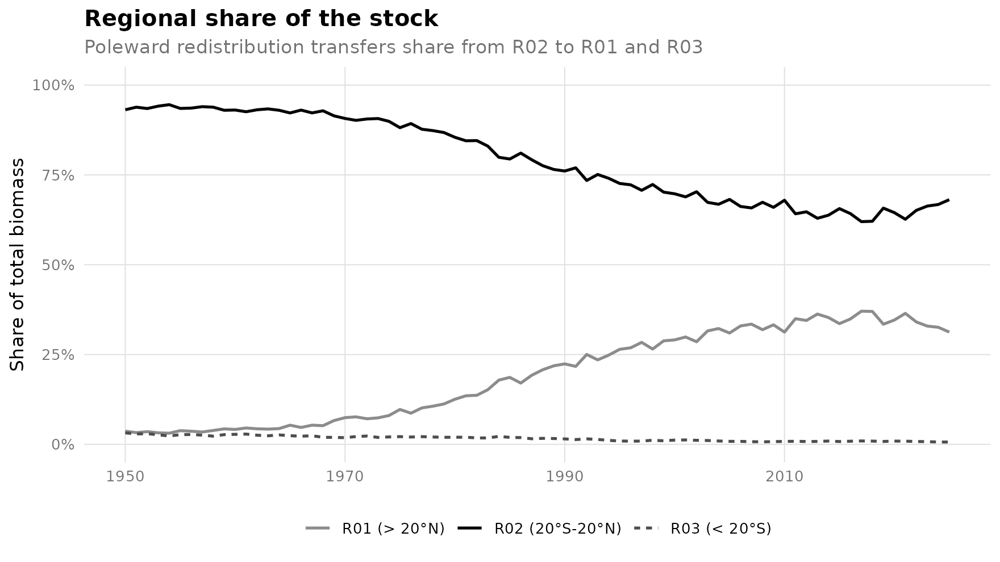
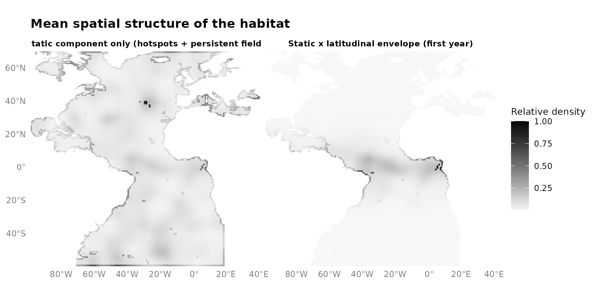
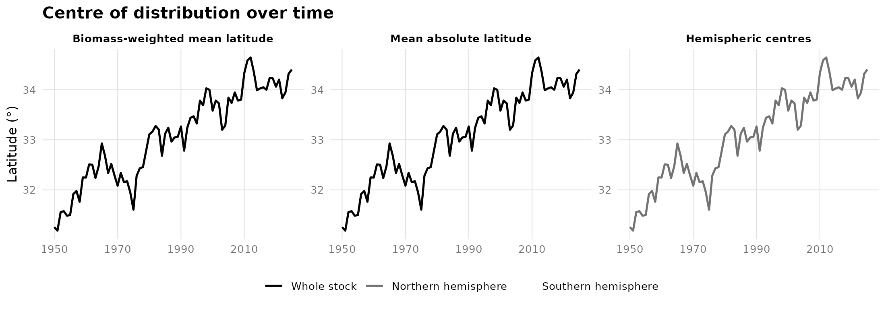
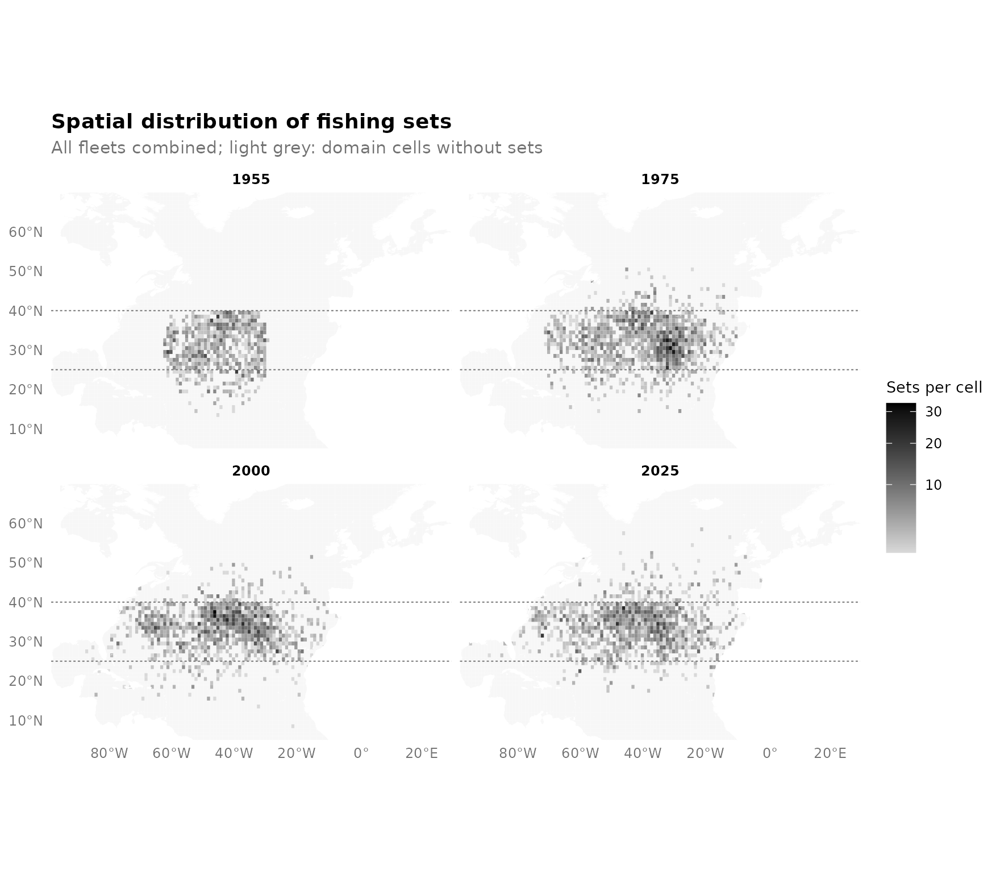
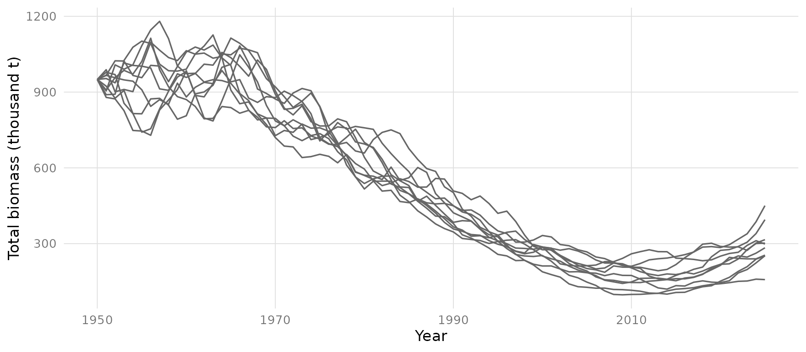

# Tuning the operating model: other species, distributions and fleets

``` r

library(pelagicOM)
library(ggplot2)
```

## How configurations work

All parameters live in two lists:
[`om_biomass_config()`](https://rodrigosantana.github.io/pelagicOM/reference/om_biomass_config.md)
(Part I) and
[`om_fishery_config()`](https://rodrigosantana.github.io/pelagicOM/reference/om_fishery_config.md)
(Part II). Both start from a preset
([`om_presets()`](https://rodrigosantana.github.io/pelagicOM/reference/om_presets.md)).
They are changed in three ways:

- in the call to the configuration function, through `...`;
- with
  [`om_config_update()`](https://rodrigosantana.github.io/pelagicOM/reference/om_config_update.md);
- by plain assignment (`cfg$population$r <- 0.4`).

[`om_config_update()`](https://rodrigosantana.github.io/pelagicOM/reference/om_config_update.md)
follows four rules:

- **named lists are merged** level by level, so only the given elements
  change;
- **vectors and unnamed lists** (hotspots, events, scenarios,
  observation periods) **replace** the original value entirely;
- `NULL` **removes** an element (for example a fleet);
- **new names** are accepted and reported with a message, which also
  catches typos.

``` r

cfg <- om_biomass_config("BET_ICCAT")
cfg2 <- om_config_update(cfg,
    population = list(r = 0.45, decline = list(u_peak = 0.35)),
    shift = list(center_drift = 3))
c(cfg2$population$r, cfg2$population$decline$u_peak,
  cfg2$population$decline$start)
#> [1]    0.45    0.35 1965.00
cfg3 <- om_config_update(cfg, population = list(R = 0.45))   # typo: reported
#> om_config_update(): new element(s) added: population$R
```

The simulation functions validate the configuration and stop with an
explicit message when something is incoherent:

``` r

bad <- cfg; bad$spatial$region_labels <- c("N", "S")
simulate_biomass(bad, verbose = FALSE)
#> Error in `validate_biomass_config()`:
#> ! spatial$region_labels must have length(region_breaks) + 1 elements (ordered from north to south)
```

Every parameter is listed in the [configuration
reference](https://rodrigosantana.github.io/pelagicOM/articles/configuration-reference.md).

## Recipes for the biomass

### Productivity and history of exploitation

``` r

fast <- om_biomass_config("BET_ICCAT",
    population = list(r = 0.6, B0_frac = 1,
                      decline = list(start = 1970, end = 1985, u_peak = 0.45),
                      recovery = list(start = 1995, end = 2010, u_end = 0.10),
                      events = list(list(year = 1983, log_shock = -0.4)),
                      K_trend = -0.002))
fig_total_biomass(simulate_biomass(fast, long_table = FALSE, verbose = FALSE))
```



### Other production models

`population$model` accepts `"pella_tomlinson"` (with `shape`),
`"logistic"` or any function `f(B, K, r, shape)`. For a user function,
the reference points are found numerically:

``` r

fox <- function(B, K, r, shape) r * B * log(K / B) / log(K)
reference_points(om_config_update(cfg, population = list(model = fox))$population)[c("Bmsy", "MSY")]
#> $Bmsy
#> [1] 367879.4
#> 
#> $MSY
#> [1] 7988.401
```

### Spatial structure

``` r

patchy <- om_biomass_config("BET_ICCAT",
    habitat = list(hotspots = list(
                       list(lon = -20, lat = 5, sd_lon = 6, sd_lat = 3, amp = 1.5),
                       list(lon = -40, lat = -10, sd_lon = 6, sd_lat = 3, amp = 1.2)),
                   lon_gradient = 0.01, field_sd = 0.8, field_range = 2),
    shift = list(enabled = FALSE))
fig_base_habitat(simulate_biomass(patchy, long_table = FALSE, verbose = FALSE))
```



### Asymmetric or drifting redistribution

``` r

north <- om_biomass_config("BET_ICCAT",
    shift = list(north_expansion = 1.2, south_expansion = 0, center_drift = 4,
                 ramp = "logistic"))
s <- simulate_biomass(north, long_table = FALSE, verbose = FALSE)
fig_region_share(s)
```



### A habitat layer of your own

`habitat$custom_effect` is a function of the cell table that returns a
log-scale value per cell. It is added to the static habitat. It can hold
a covariate or a distance to the coast, for example. It should not draw
random numbers, so that the order of the random draws is kept.

``` r

coastal <- function(cells) 1.5 * (cells$Area_frac < 1)  # boost coastal cells
s <- simulate_biomass(om_biomass_config("BET_ICCAT",
                          habitat = list(custom_effect = coastal)),
                      long_table = FALSE, verbose = FALSE)
fig_base_habitat(s)
```



## Recipes for the fishery

``` r

fcfg <- om_fishery_config("BET_ICCAT")

## fleets: remove, resize, create
fcfg <- om_config_update(fcfg, fleets = list(E = NULL, A = list(n_vessels = 60)))
fcfg$fleets$F <- om_fleet(n_vessels = 25, year_start = 1985, regions = "R02",
                          core_lon = -10, core_lat = 0, q_effect = 0.2,
                          strategy_comp = c(S1 = 0.7, S2 = 0.2, S3 = 0.1))

## catchability: no creep, stronger HBF effect, no preferential sampling
fcfg <- om_config_update(fcfg,
    catchability = list(creep_enabled = FALSE, hbf = list(effect = 2)),
    spatial = list(preferential_sampling_strength = 0, fidelity = 0))

## catch process and seeds
fcfg$catch_process$distribution <- "delta_lognormal"
fcfg$reproducibility$seeds$catch <- 1
```

## Complete example: a temperate tuna in the North Atlantic

This example puts together several of the changes above:

- the ALB-N stock area with three regions;
- an envelope on the absolute latitude with a preferred latitude of 32
  degrees, drifting 4 degrees poleward;
- two fleets;
- ALB as target species, with BET and SWO as companions;
- scenarios defined for the new regions.

``` r

dom <- om_domain_iccat("ALB-N", region_breaks = c(25, 40),
                       region_labels = c("NORTH", "CENTRAL", "SOUTH"))
#>   domain ALB-N: 5070 cells | lattice 65 x 129
alb <- om_biomass_config("BET_ICCAT",
    general    = list(label = "alb_n", seed = 2027),
    population = list(K = 5e5, r = 0.25, B0_frac = 0.90,
                      decline = list(start = 1960, end = 1990, u_peak = 0.20),
                      recovery = list(start = 2000, end = 2015, u_end = 0.08)),
    habitat    = list(envelope_type = "abs_latitude", lat_center = 32,
                      lat_sd_north = 7, lat_sd_south = 9,
                      hotspots = list(list(lon = -40, lat = 35, sd_lon = 12,
                                           sd_lat = 5, amp = 0.8))),
    shift      = list(north_expansion = 0, south_expansion = 0,
                      center_drift = 4))
sim_alb <- simulate_biomass(alb, dom, verbose = FALSE)
sim_alb
#> <pelagicOM biomass truth> label 'alb_n' | seed 2027
#>   5070 cells x 76 years (1950-2025) | stock area ALB-N
#>   B_total: 450,000 t (1950) -> 311,105 t (2025) | B/K 0.90 -> 0.62 | Bmsy 250,000 t
#>   regional share: NORTH 0.07 -> 0.17 | CENTRAL 0.77 -> 0.76 | SOUTH 0.16 -> 0.07
```

``` r

fig_maps(sim_alb)
```


``` r

fig_centre_gravity(sim_alb)
```



``` r

fcfg_alb <- om_fishery_config("BET_ICCAT", general = list(label = "alb_n"))
fcfg_alb$fleets <- list(
    JPN = om_fleet(n_vessels = 20, year_start = 1955,
                   regions = c("CENTRAL", "SOUTH"),
                   core_lon = -45, core_lat = 30),
    TWN = om_fleet(n_vessels = 15, year_start = 1965,
                   regions = c("NORTH", "CENTRAL", "SOUTH"),
                   core_lon = -35, core_lat = 38, q_effect = -0.2,
                   strategy_comp = c(S1 = 0.2, S2 = 0.6, S3 = 0.2)))
fcfg_alb$catchability$region_effect <- c(NORTH = 0, CENTRAL = 0, SOUTH = 0)
fcfg_alb$species$target <- "ALB"
fcfg_alb$species$companions <- c("BET", "SWO")
fcfg_alb$species$params <- list(BET = fcfg_alb$species$params$YFT,
                                SWO = fcfg_alb$species$params$SWO)
fcfg_alb$scenarios <- list(
    list(name = "01_all_complete", regions = c("NORTH", "CENTRAL", "SOUTH"),
         drop = character(0), observation = "complete",
         objective = "reference"),
    list(name = "02_central_temporal", regions = "CENTRAL",
         drop = character(0), observation = "temporal",
         objective = "degraded early data"))
fish_alb <- simulate_fishery(sim_alb, fcfg_alb, verbose = FALSE)
fish_alb
#> <pelagicOM fishery truth> label 'alb_n'
#>   201,808 sets | 17,510 trips | 139 vessels | 2 fleets | 1955-2025
#>   target catch: total 131,625 t | mean 0.652 t/set | zeros 40.3%
#>   sets by fleet x region:
#>      
#>       CENTRAL  NORTH  SOUTH
#>   JPN  113617      0   9244
#>   TWN   62856  12372   3719
generate_scenarios(fish_alb, verbose = FALSE)
#> <pelagicOM scenario data sets> 2 data sets
#>   01_all_complete                    201808 sets  NORTH+CENTRAL+SOUTH complete
#>   02_central_temporal                167396 sets  CENTRAL      temporal
```

``` r

fig_effort_maps(fish_alb)
```



``` r

fig_cpue_vs_biomass(fish_alb)
```


## Another ocean with a synthetic grid

``` r

## default regions R01 (> 20N), R02, R03 (< 20S), as in Experimento 02
basin <- om_domain_grid(lon = c(40, 100), lat = c(-40, 30),
                        exclude = function(lon, lat) lat > 10 & lon < 60,
                        verbose = FALSE)
table(basin$cells$Region)
#> 
#>  R01  R02  R03 
#>  400 2200 1200
b_cfg <- om_biomass_config("BET_ICCAT",
    habitat = list(hotspots = list(list(lon = 70, lat = -5, sd_lon = 10,
                                        sd_lat = 5, amp = 1))))
b_sim <- simulate_biomass(b_cfg, basin, long_table = FALSE, verbose = FALSE)
f_cfg <- om_fishery_config("BET_ICCAT")
f_cfg$fleets <- list(
    N = om_fleet(n_vessels = 10, regions = c("R01", "R02"),
                 core_lon = 65, core_lat = 0),
    S = om_fleet(n_vessels = 8, year_start = 1970, regions = c("R02", "R03"),
                 core_lon = 80, core_lat = -25))
b_fish <- simulate_fishery(b_sim, f_cfg, verbose = FALSE)
b_fish
#> <pelagicOM fishery truth> label 'base'
#>   104,864 sets | 9,103 trips | 70 vessels | 2 fleets | 1950-2025
#>   target catch: total 64,145 t | mean 0.612 t/set | zeros 40.0%
#>   sets by fleet x region:
#>    
#>       R01   R02   R03
#>   N   855 65398     0
#>   S     0 33162  5449
```

## Seeds and replicates

Replicates of the same operating model only need different seeds. The
example below draws ten replicates of the total biomass:

``` r

reps <- do.call(rbind, lapply(1:10, function(k) {
    s <- simulate_biomass(om_biomass_config("BET_ICCAT",
                              general = list(seed = 1000 + k)),
                          long_table = FALSE, verbose = FALSE)
    data.frame(Year = s$pop$Year, B = s$pop$B_total, rep = k)
}))
ggplot(reps, aes(Year, B / 1e3, group = rep)) + geom_line(colour = "grey40") +
    labs(y = "Total biomass (thousand t)") + theme_pub()
```



For the fishery, change `reproducibility$seeds`. Changing only one seed
(for example `catch`) gives a new realisation of that process alone.
