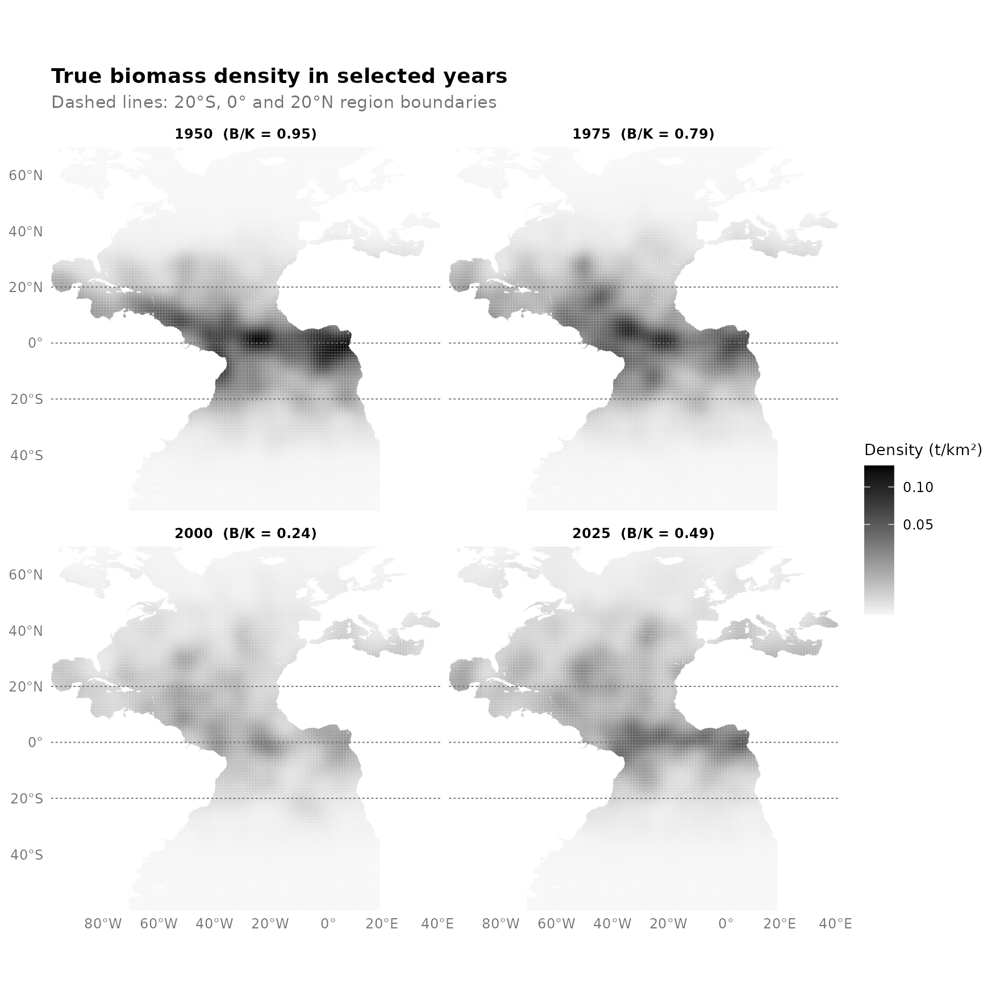
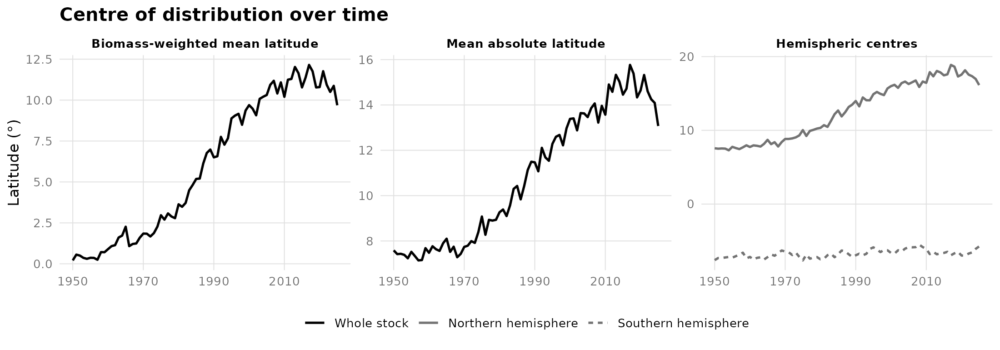
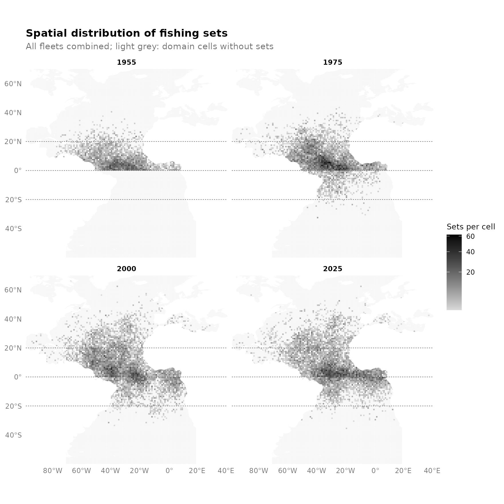
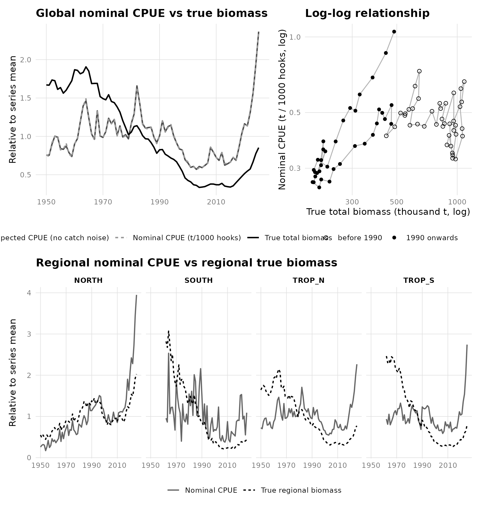

# Tuning the operating model: hypotheses, distributions and fleets

``` r

library(pelagicOM)
library(ggplot2)
```

## How configurations work

All parameters live in two lists:
[`om_biomass_config()`](https://rodrigosantana.github.io/pelagicOM/reference/om_biomass_config.md)
(Part I) and
[`om_fishery_config()`](https://rodrigosantana.github.io/pelagicOM/reference/om_fishery_config.md)
(Part II). Both start from a preset
([`om_presets()`](https://rodrigosantana.github.io/pelagicOM/reference/om_presets.md)).
They are changed in three ways:

- in the call to the configuration function, through `...`;
- with
  [`om_config_update()`](https://rodrigosantana.github.io/pelagicOM/reference/om_config_update.md);
- by plain assignment (`cfg$population$r <- 0.4`).

[`om_config_update()`](https://rodrigosantana.github.io/pelagicOM/reference/om_config_update.md)
follows four rules:

- **named lists are merged** level by level, so only the given elements
  change;
- **vectors and unnamed lists** (hotspots, events, scenarios,
  observation periods) **replace** the original value entirely;
- `NULL` **removes** an element (for example a fleet);
- **new names** are accepted and reported with a message, which also
  catches typos.

``` r

cfg <- om_biomass_config("BET_ICCAT")
cfg2 <- om_config_update(cfg,
    population = list(r = 0.45, decline = list(u_peak = 0.35)),
    shift = list(center_drift = 3))
c(cfg2$population$r, cfg2$population$decline$u_peak,
  cfg2$population$decline$start)
#> [1]    0.45    0.35 1965.00
cfg3 <- om_config_update(cfg, population = list(R = 0.45))   # typo: reported
#> om_config_update(): new element(s) added: population$R
```

The simulation functions validate the configuration and stop with an
explicit message when something is incoherent:

``` r

bad <- cfg; bad$spatial$region_labels <- c("N", "S")
simulate_biomass(bad, verbose = FALSE)
#> Error in `validate_biomass_config()`:
#> ! spatial$region_labels must have length(region_breaks) + 1 elements (ordered from north to south)
```

Every parameter is listed in the [configuration
reference](https://rodrigosantana.github.io/pelagicOM/articles/configuration-reference.md).

## Recipes for the biomass

### Productivity and history of exploitation

``` r

fast <- om_biomass_config("BET_ICCAT",
    population = list(r = 0.6, B0_frac = 1,
                      decline = list(start = 1970, end = 1985, u_peak = 0.45),
                      recovery = list(start = 1995, end = 2010, u_end = 0.10),
                      events = list(list(year = 1983, log_shock = -0.4)),
                      K_trend = -0.002))
fig_total_biomass(simulate_biomass(fast, long_table = FALSE, verbose = FALSE))
```


### Other production models

`population$model` accepts `"pella_tomlinson"` (with `shape`),
`"logistic"` or any function `f(B, K, r, shape)`. For a user function,
the reference points are found numerically:

``` r

fox <- function(B, K, r, shape) r * B * log(K / B) / log(K)
reference_points(om_config_update(cfg, population = list(model = fox))$population)[c("Bmsy", "MSY")]
#> $Bmsy
#> [1] 367879.4
#> 
#> $MSY
#> [1] 7988.401
```

### Spatial structure

``` r

patchy <- om_biomass_config("BET_ICCAT",
    habitat = list(hotspots = list(
                       list(lon = -20, lat = 5, sd_lon = 6, sd_lat = 3, amp = 1.5),
                       list(lon = -40, lat = -10, sd_lon = 6, sd_lat = 3, amp = 1.2)),
                   lon_gradient = 0.01, field_sd = 0.8, field_range = 2),
    shift = list(enabled = FALSE))
fig_base_habitat(simulate_biomass(patchy, long_table = FALSE, verbose = FALSE))
```


### Asymmetric or drifting redistribution

``` r

north <- om_biomass_config("BET_ICCAT",
    shift = list(north_expansion = 1.2, south_expansion = 0, center_drift = 4,
                 ramp = "logistic"))
s <- simulate_biomass(north, long_table = FALSE, verbose = FALSE)
fig_region_share(s)
```


### A habitat layer of your own

`habitat$custom_effect` is a function of the cell table that returns a
log-scale value per cell. It is added to the static habitat. It can hold
a covariate or a distance to the coast, for example. It should not draw
random numbers, so that the order of the random draws is kept.

``` r

coastal <- function(cells) 1.5 * (cells$Area_frac < 1)  # boost coastal cells
s <- simulate_biomass(om_biomass_config("BET_ICCAT",
                          habitat = list(custom_effect = coastal)),
                      long_table = FALSE, verbose = FALSE)
fig_base_habitat(s)
```


## Recipes for the fishery

``` r

fcfg <- om_fishery_config("BET_ICCAT")

## fleets: remove, resize, create
fcfg <- om_config_update(fcfg, fleets = list(E = NULL, A = list(n_vessels = 60)))
fcfg$fleets$F <- om_fleet(n_vessels = 25, year_start = 1985, regions = "R02",
                          core_lon = -10, core_lat = 0, q_effect = 0.2,
                          strategy_comp = c(S1 = 0.7, S2 = 0.2, S3 = 0.1))

## catchability: no creep, stronger HBF effect, no preferential sampling
fcfg <- om_config_update(fcfg,
    catchability = list(creep_enabled = FALSE, hbf = list(effect = 2)),
    spatial = list(preferential_sampling_strength = 0, fidelity = 0))

## catch process and seeds
fcfg$catch_process$distribution <- "delta_lognormal"
fcfg$reproducibility$seeds$catch <- 1
```

## Complete example: an alternative operating model for BET

This example puts together several of the changes above into an
alternative hypothesis for BET. In this hypothesis:

- **Productivity and exploitation:** the stock is more productive (*r* =
  0.40) and more heavily exploited (`u_peak = 0.32`).
- **Redistribution:** it is not symmetric. The envelope widens only to
  the north and its centre drifts 3 degrees north (logistic ramp).
- **Regions:** the tropical band is split at the equator, giving four
  regions (NORTH, TROP_N, TROP_S, SOUTH).
- **Fleets:** fleet E leaves the fishery, and a new fleet F enters in
  1990 in the southern tropics, with a deep-set strategy and a higher
  catchability. The creep doubles.
- **Scenarios:** they are redefined for the new regions.

``` r

dom4 <- om_domain_iccat("BET-A", region_breaks = c(-20, 0, 20),
                        region_labels = c("NORTH", "TROP_N", "TROP_S", "SOUTH"))
#>   domain BET-A: 10051 cells | lattice 130 x 140
alt <- om_biomass_config("BET_ICCAT",
    general    = list(label = "bet_alt"),
    population = list(r = 0.40, decline = list(u_peak = 0.32)),
    shift      = list(north_expansion = 1.0, south_expansion = 0,
                      center_drift = 3, ramp = "logistic"))
sim_alt <- simulate_biomass(alt, dom4, verbose = FALSE)
sim_alt
#> <pelagicOM biomass truth> label 'bet_alt' | seed 20261005
#>   10051 cells x 76 years (1950-2025) | stock area BET-A
#>   B_total: 950,000 t (1950) -> 485,168 t (2025) | B/K 0.95 -> 0.49 | Bmsy 5e+05 t
#>   regional share: NORTH 0.04 -> 0.27 | TROP_N 0.48 -> 0.44 | TROP_S 0.45 -> 0.29 | SOUTH 0.03 -> 0.01
```

``` r

fig_maps(sim_alt)
```



``` r

fig_region_share(sim_alt)
```


``` r

fig_centre_gravity(sim_alt)
```



The fishery follows the new regions. In the preset, fleets A-C fish
R01+R02 and fleet D fishes R02+R03, so their `regions` are rewritten
with the new labels:

``` r

fcfg_alt <- om_fishery_config("BET_ICCAT",
    general = list(label = "bet_alt"),
    fleets = list(
        A = list(regions = c("NORTH", "TROP_N")),
        B = list(regions = c("NORTH", "TROP_N")),
        C = list(regions = c("NORTH", "TROP_N")),
        D = list(regions = c("TROP_N", "TROP_S", "SOUTH")),
        E = NULL),                                    # fleet E removed
    catchability = list(creep = 0.02,
                        region_effect = c(NORTH = 0, TROP_N = 0,
                                          TROP_S = 0, SOUTH = 0)))
fcfg_alt$fleets$F <- om_fleet(n_vessels = 30, year_start = 1990,
                              regions = c("TROP_S", "SOUTH"),
                              core_lon = -5, core_lat = -10, q_effect = 0.15,
                              strategy_comp = c(S1 = 0.7, S2 = 0.2, S3 = 0.1))
fcfg_alt$scenarios <- list(
    list(name = "01_global_complete",
         regions = c("NORTH", "TROP_N", "TROP_S", "SOUTH"),
         drop = character(0), observation = "complete",
         objective = "Reference"),
    list(name = "02_tropical_south_without_hbf", regions = "TROP_S",
         drop = "HooksBetweenFloats", observation = "complete",
         objective = "Area of the new fleet, without HBF"),
    list(name = "03_north_temporal", regions = "NORTH",
         drop = character(0), observation = "temporal",
         objective = "Northern region with degraded early data"))
fish_alt <- simulate_fishery(sim_alt, fcfg_alt, verbose = FALSE)
fish_alt
#> <pelagicOM fishery truth> label 'bet_alt'
#>   1,080,614 sets | 93,853 trips | 788 vessels | 5 fleets | 1950-2025
#>   target catch: total 870,061 t | mean 0.805 t/set | zeros 38.6%
#>   sets by fleet x region:
#>    
#>      NORTH  SOUTH TROP_N TROP_S
#>   A  57991      0 238014      0
#>   B  35113      0 228191      0
#>   C  50164      0 155968      0
#>   D      0   3971 117085 100859
#>   F      0   3012      0  90246
generate_scenarios(fish_alt, verbose = FALSE)
#> <pelagicOM scenario data sets> 3 data sets
#>   01_global_complete                1080614 sets  NORTH+TROP_N+TROP_S+SOUTH complete
#>   02_tropical_south_without_hbf      191105 sets  TROP_S       complete
#>   03_north_temporal                  140012 sets  NORTH        temporal
```

``` r

fig_effort_maps(fish_alt)
```



``` r

fig_cpue_vs_biomass(fish_alt)
```



## BET on an idealised Atlantic

A synthetic domain
([`om_domain_grid()`](https://rodrigosantana.github.io/pelagicOM/reference/om_domain_grid.md))
keeps the BET operating model but removes the coastline. It is useful to
separate the effects of the coast and of the clipped cells from the rest
of the model. This example uses a reduced fleet:

``` r

## default regions R01 (> 20N), R02, R03 (< 20S), as in Experimento 02
box <- om_domain_grid(lon = c(-60, 15), lat = c(-45, 45),
                      exclude = function(lon, lat) lon > 0 & lat > 10,
                      verbose = FALSE)
table(box$cells$Region)
#> 
#>  R01  R02  R03 
#> 1500 2850 1875
b_sim <- simulate_biomass(om_biomass_config("BET_ICCAT"), box,
                          long_table = FALSE, verbose = FALSE)
b_fish <- simulate_fishery(b_sim, om_fishery_config("BET_ICCAT",
    fleets = list(A = list(n_vessels = 10), B = list(n_vessels = 10),
                  C = list(n_vessels = 8), D = list(n_vessels = 10),
                  E = list(n_vessels = 8))), verbose = FALSE)
b_fish
#> <pelagicOM fishery truth> label 'base'
#>   274,308 sets | 23,828 trips | 194 vessels | 5 fleets | 1950-2025
#>   target catch: total 81,566 t | mean 0.297 t/set | zeros 55.2%
#>   sets by fleet x region:
#>    
#>       R01   R02   R03
#>   A  5540 60713     0
#>   B  3073 62224     0
#>   C  5474 41700     0
#>   D     0 51613  3773
#>   E     0 34488  5710
```

## Seeds and replicates

Replicates of the same operating model only need different seeds. The
example below draws ten replicates of the total biomass:

``` r

reps <- do.call(rbind, lapply(1:10, function(k) {
    s <- simulate_biomass(om_biomass_config("BET_ICCAT",
                              general = list(seed = 1000 + k)),
                          long_table = FALSE, verbose = FALSE)
    data.frame(Year = s$pop$Year, B = s$pop$B_total, rep = k)
}))
ggplot(reps, aes(Year, B / 1e3, group = rep)) + geom_line(colour = "grey40") +
    labs(y = "Total biomass (thousand t)") + theme_pub()
```


For the fishery, change `reproducibility$seeds`. Changing only one seed
(for example `catch`) gives a new realisation of that process alone.
